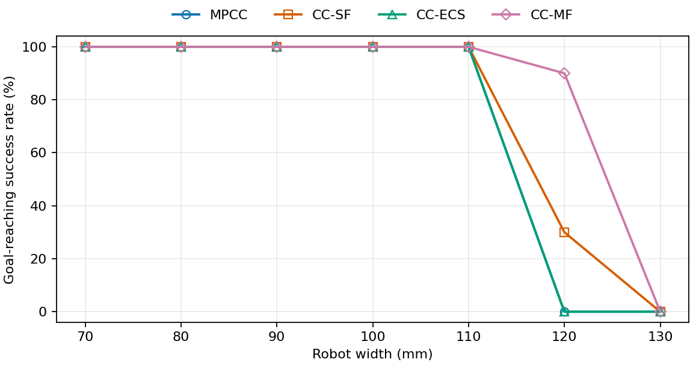

# Rectangle width별 controller benchmark 결과

## 실험 조건

기존 폭 비교 실험의 조건은 아래와 같다. 초기 σ·scale을 바꾼 추가 0.120m 실험은 마지막 표에 별도 조건을 표시했다.

- 실행일: 2026-10-29 (KST). Rectangle, maze, differential drive (DD), A* global planner.
- Robot 길이 0.150m 고정, width **0.100 / 0.105 / 0.110 / 0.115 / 0.120m**. MPCC·CC-SF·CC-ECS·CC-MF를 각 폭에서 **5회씩, 총 100회 순차 실행**했다.
- 시작 자세: seed 0–4, x/y Gaussian 표준편차 각각 0.02m, heading 표준편차 0.05rad, 각 성분 ±3σ 제한, 초기 clearance ≥ 0.01m. 같은 폭·seed에서 네 controller의 시작 자세는 같다. 폭이 달라지면 clearance 조건에 따른 재샘플링으로 시작 자세가 달라질 수 있다. Localization error는 끈다.
- CC controller의 초기 표준편차는 **σf=0.0002m, σl=0, σψ=0**. Log-Cholesky에서 0을 표현하기 위한 내부 분산은 10⁻²⁴이며 설정값은 0으로 유지했다. 나머지는 현행 controller 기본값을 사용했다. 안전 거리 d_min은 MPCC·CC-SF·CC-ECS 1mm, CC-MF 0.2mm이며, CC-ECS의 process noise는 0이다.
- 제어 주기 dt=0.1초, prediction horizon 20 step. Trial 제한 60초. 목표 위치의 L1 오차 ≤ 0.02m이면 성공하며, 별도 heading 조건은 없다. 4초 동안 위치 변화 ≤ 0.03m 또는 제어 실패 연속 20회이면 실패로 종료한다.
- 네 controller 모두 `a_max=0.1m/s²`, `alpha_max=3.5rad/s²`로 동일하다.
- **Success Rate**: 목표 도달 trial / 완료한 5 trials. 접촉·겹침을 별도 실패로 판정하지 않는 기존 도달 기준이다. **Mean Traversal time**: 성공 trial만의 평균 시뮬레이션 시간(s); 성공이 없으면 `—`.
- **Mean/P05 clearance**: 실제 rectangle footprint와 모든 장애물 사이의 정확한 polygon 거리 및 지도 경계 margin 중 최솟값(mm). 접촉·겹침은 0, 경계 침범은 음수다. 초기 자세와 모든 적분 후 자세를 포함하여 성공·실패 trial의 전체 표본을 합쳐 계산했다.
- **Mean/P95 computation time per step**: local reference 생성부터 controller의 전처리·파라미터 갱신·solver·복구·호출 내부 로깅까지 한 제어 사이클의 wall-clock 시간(ms/step). `time.perf_counter()`와 CUDA 동기화를 사용했다. 각 trial의 첫 사이클은 초기화·코드 생성·컴파일을 포함하므로 제외하고, 이후에는 실패·safe stop step도 모두 포함했다. Global path 생성·plant 적분·실험 종료 후 파일 저장은 제외했다. Clearance와 시간 분위수는 trial별 분위수의 평균이 아니라 전체 표본의 선형 보간 분위수다.
- **Safe stop**: 5 trials에서 zero-input fallback이 발동한 제어 step의 총수. 연속 정지도 매 step을 각각 센다. MPCC에는 이 fallback이 없으므로 0은 별도 정지 복구가 없음을 뜻한다. `≥`는 native crash로 일부 계측이 없어 확인된 횟수의 하한만 표시한 값이다.
- 63번째 trial부터는 주행 종료 후 기본 animation을 `animations/<controller>/`에 저장했다. 이전 trial과 궤적 저장 전 native crash로 종료한 trial에는 영상이 없다. Plot은 생성하지 않았으며, animation 생성 시간은 제어 사이클 시간에 포함하지 않는다.
- 실행 환경: Python 3.11.8, PyTorch 2.7.1+cu118, CasADi 3.7.0, NVIDIA GeForce RTX 3060, PyTorch CPU thread 6개. [이번 실행 원본·설정](benchmark_runs/rectangle_width_100_120mm_sigmaf_5trials_20261029/experiment.json), [폭별 집계](benchmark_runs/rectangle_width_100_120mm_sigmaf_5trials_20261029/benchmark_summary.csv).

## 주요 결과

- **0.120m에서 초기 σ와 covariance growth scale을 바꾼 추가 실험**의 성공 횟수는 MPCC 1/5 → 1/5, CC-SF 0/5 → 4/5, CC-ECS 0/5 → 0/5, CC-MF 2/5 → 1/5였다. 두 설정을 함께 바꾼 결과이며, 아래에 별도 표로 정리했다.
- **폭이 커질수록 성공률이 낮아졌다.** 0.100m에서는 네 controller 모두 100%였고, 0.110m에서는 CC-MF만 60%, 나머지는 100%였다. 0.115m에서는 CC-ECS가 100%를 유지했고 MPCC·CC-SF·CC-MF는 각각 40%·20%·60%였다. 0.120m에서는 CC-MF 40%, MPCC 20%, CC-SF·CC-ECS 0%였다. CC-SF의 실패에는 native crash 7회가 포함된다.
- **Mean clearance는 모든 controller에서 폭 증가에 따라 감소했다.** 0.100m의 8.196–9.049mm에서 0.120m의 3.744–4.850mm로 줄었다. MPCC는 0.115m와 0.120m에서 P05 clearance가 0이었다. CC-SF의 0.115m·0.120m clearance와 계산 시간은 native crash 때문에 각각 1회·2회의 저장된 주행만으로 집계했다.
- **성공한 주행의 traversal time은 길어졌다.** MPCC는 폭 0.100m의 27.28초에서 0.120m의 39.50초로, CC-MF는 33.88초에서 47.70초로 늘었다. 0.120m 수치는 각각 성공 1회·2회의 평균이며, 성공이 없는 CC-SF·CC-ECS는 평균을 표시하지 않았다.
- **기존 폭 비교 실험의 제어 사이클 평균 계산 시간은 25.797–36.575ms/step, P95는 33.017–62.747ms/step이었다.** 폭에 따라 일관되게 증가하지는 않았다. 실패 trial의 조기 종료·safe stop과 native crash에 따른 계측 누락으로 표본 구성이 달라지므로, 큰 폭에서 시간이 짧아진 값을 계산 성능 향상으로 해석하지 않았다.

## Robot width별 결과

### Robot width 0.100m

| Controller | Success Rate | Mean clearance (mm) | P05 clearance (mm) | Mean computation time (ms/step) | P95 computation time (ms/step) | Mean Traversal time (s) | Safe stop (회) |
|---|---:|---:|---:|---:|---:|---:|---:|
| MPCC | 100% (5/5) | 8.196 | 1.331 | 28.937 | 45.186 | 27.28 | 0 |
| CC-SF | 100% (5/5) | 9.049 | 2.250 | 31.627 | 45.410 | 29.38 | 0 |
| CC-ECS | 100% (5/5) | 8.521 | 1.394 | 32.073 | 42.526 | 29.78 | 0 |
| CC-MF | 100% (5/5) | 8.358 | 1.612 | 33.516 | 48.192 | 33.88 | 0 |

**실패 trial**

없음.

### Robot width 0.105m

| Controller | Success Rate | Mean clearance (mm) | P05 clearance (mm) | Mean computation time (ms/step) | P95 computation time (ms/step) | Mean Traversal time (s) | Safe stop (회) |
|---|---:|---:|---:|---:|---:|---:|---:|
| MPCC | 100% (5/5) | 7.601 | 1.259 | 28.796 | 41.175 | 28.62 | 0 |
| CC-SF | 100% (5/5) | 7.657 | 2.263 | 31.337 | 41.712 | 30.92 | 0 |
| CC-ECS | 100% (5/5) | 7.746 | 1.346 | 32.661 | 46.845 | 31.60 | 0 |
| CC-MF | 80% (4/5) | 7.675 | 1.340 | 33.364 | 48.425 | 34.33 | 20 |

**실패 trial**

| Controller | Trial (seed) | 종료 시간 (s) | 실패 사유 |
|---|---:|---:|---|
| CC-MF | 1 (0) | 14.8 | 현재 자세의 stage-0 guard 미충족 → solver 미호출 safe stop 20 step 연속 |

### Robot width 0.110m

| Controller | Success Rate | Mean clearance (mm) | P05 clearance (mm) | Mean computation time (ms/step) | P95 computation time (ms/step) | Mean Traversal time (s) | Safe stop (회) |
|---|---:|---:|---:|---:|---:|---:|---:|
| MPCC | 100% (5/5) | 6.112 | 1.147 | 30.805 | 46.609 | 30.28 | 0 |
| CC-SF | 100% (5/5) | 6.316 | 2.161 | 32.369 | 45.884 | 34.24 | 1 |
| CC-ECS | 100% (5/5) | 6.008 | 1.185 | 33.846 | 47.135 | 36.00 | 8 |
| CC-MF | 60% (3/5) | 6.245 | 1.247 | 36.575 | 62.747 | 38.20 | 40 |

**실패 trial**

| Controller | Trial (seed) | 종료 시간 (s) | 실패 사유 |
|---|---:|---:|---|
| CC-MF | 2 (1) | 36.6 | 현재 자세의 stage-0 guard 미충족 → solver 미호출 safe stop 20 step 연속 |
| CC-MF | 3 (2) | 20.8 | 현재 자세의 stage-0 guard 미충족 → solver 미호출 safe stop 20 step 연속 |

### Robot width 0.115m

| Controller | Success Rate | Mean clearance (mm) | P05 clearance (mm) | Mean computation time (ms/step) | P95 computation time (ms/step) | Mean Traversal time (s) | Safe stop (회) |
|---|---:|---:|---:|---:|---:|---:|---:|
| MPCC | 40% (2/5) | 4.953 | 0.000 | 27.826 | 39.863 | 33.20 | 0 |
| CC-SF | 20% (1/5) | 5.445 | 1.927 | 34.179 | 48.666 | 38.20 | ≥8 |
| CC-ECS | 100% (5/5) | 4.173 | 1.105 | 30.647 | 39.827 | 42.50 | 0 |
| CC-MF | 60% (3/5) | 5.329 | 1.085 | 31.377 | 41.118 | 43.60 | 22 |

CC-SF의 native crash 4회는 성공률 분모에 포함했다. Clearance·계산 시간은 계측이 저장된 1회를 집계했으며, safe stop은 로그에서 확인한 하한이다.

**실패 trial**

| Controller | Trial (seed) | 종료 시간 (s) | 실패 사유 |
|---|---:|---:|---|
| MPCC | 2 (1) | 12.2 | Solver 연속 20회 실패 |
| MPCC | 3 (2) | 12.3 | Solver 연속 20회 실패 |
| MPCC | 4 (3) | 11.9 | Solver 연속 20회 실패 |
| CC-SF | 1 (0) | — | acados backup 복구 처리 중 native crash (exit 139). 종료 시각·step별 계측은 저장되지 않음 |
| CC-SF | 3 (2) | — | acados backup 복구 처리 중 native crash (exit 139). 종료 시각·step별 계측은 저장되지 않음 |
| CC-SF | 4 (3) | — | acados backup 복구 처리 중 native crash (exit 139). 종료 시각·step별 계측은 저장되지 않음 |
| CC-SF | 5 (4) | — | acados backup 복구 처리 중 native crash (exit 139). 종료 시각·step별 계측은 저장되지 않음 |
| CC-MF | 1 (0) | 22.0 | 현재 자세의 stage-0 guard 미충족 → solver 미호출 safe stop 20 step 연속 |
| CC-MF | 2 (1) | 10.0 | 4초 동안 위치 변화 ≤ 0.03m (실측 0.0277m) |

### Robot width 0.120m

| Controller | Success Rate | Mean clearance (mm) | P05 clearance (mm) | Mean computation time (ms/step) | P95 computation time (ms/step) | Mean Traversal time (s) | Safe stop (회) |
|---|---:|---:|---:|---:|---:|---:|---:|
| MPCC | 20% (1/5) | 3.903 | 0.000 | 25.797 | 33.017 | 39.50 | 0 |
| CC-SF | 0% (0/5) | 4.624 | 1.744 | 32.566 | 46.231 | — | ≥34 |
| CC-ECS | 0% (0/5) | 3.744 | 1.070 | 28.088 | 35.999 | — | 0 |
| CC-MF | 40% (2/5) | 4.850 | 0.964 | 30.852 | 40.983 | 47.70 | 29 |

CC-SF의 native crash 3회는 성공률 분모에 포함했다. Clearance·계산 시간은 계측이 저장된 2회를 집계했으며, safe stop은 로그에서 확인한 하한이다.

**실패 trial**

| Controller | Trial (seed) | 종료 시간 (s) | 실패 사유 |
|---|---:|---:|---|
| MPCC | 2 (1) | 8.7 | Solver 연속 20회 실패 |
| MPCC | 3 (2) | 13.7 | Solver 연속 20회 실패 |
| MPCC | 4 (3) | 23.8 | Solver 연속 20회 실패 |
| MPCC | 5 (4) | 13.6 | Solver 연속 20회 실패 |
| CC-SF | 1 (0) | — | acados backup 복구 처리 중 native crash (exit 139). 종료 시각·step별 계측은 저장되지 않음 |
| CC-SF | 2 (1) | — | acados backup 복구 처리 중 native crash (exit 139). 종료 시각·step별 계측은 저장되지 않음 |
| CC-SF | 3 (2) | 33.6 | 4초 동안 위치 변화 ≤ 0.03m (실측 0.0292m) |
| CC-SF | 4 (3) | — | acados backup 복구 처리 중 native crash (exit 139). 종료 시각·step별 계측은 저장되지 않음 |
| CC-SF | 5 (4) | 11.9 | 4초 동안 위치 변화 ≤ 0.03m (실측 0.0273m) |
| CC-ECS | 1 (0) | 11.4 | 4초 동안 위치 변화 ≤ 0.03m (실측 0.0291m) |
| CC-ECS | 2 (1) | 11.2 | 4초 동안 위치 변화 ≤ 0.03m (실측 0.0288m) |
| CC-ECS | 3 (2) | 11.5 | 4초 동안 위치 변화 ≤ 0.03m (실측 0.0293m) |
| CC-ECS | 4 (3) | 11.4 | 4초 동안 위치 변화 ≤ 0.03m (실측 0.0291m) |
| CC-ECS | 5 (4) | 11.4 | 4초 동안 위치 변화 ≤ 0.03m (실측 0.0291m) |
| CC-MF | 2 (1) | 17.7 | 4초 동안 위치 변화 ≤ 0.03m (실측 0.0293m) |
| CC-MF | 3 (2) | 16.5 | 4초 동안 위치 변화 ≤ 0.03m (실측 0.0266m) |
| CC-MF | 4 (3) | 30.0 | 현재 자세의 stage-0 guard 미충족 → solver 미호출 safe stop 20 step 연속 |

### Robot width 0.120m — 초기 σ 변경·scale 0.8

- Rectangle 길이 0.150m, 폭 0.120m, maze, DD, A*. 네 controller 각각 5회, seed 0–4, 총 20회 순차 실행했다. 시작 자세 교란·실패 기준·지표 집계 방식은 위와 같다.
- CC controller 초기 표준편차: **σf=0.0002m, σl=0.00025m, σψ=0.00025rad**. CC-SF·CC-MF의 **covariance_growth_scale=0.8**이며, 기존 0.6 계수를 4/3배 했다. 실제 계수는 alpha_f=0.0016, alpha_v=0.00032, alpha_kappa=0.0004, beta_v=0.016, beta_kappa=beta_omega=0.0064다. CC-ECS는 process noise 0을 유지하고 초기 불확실성만 변경했다. MPCC에는 불확실성 모델이 없다.
- 네 controller 모두 a_max=0.1m/s², alpha_max=3.5rad/s². Animation은 주행 종료 후 `animations/<controller>/`에 저장하며 계산 시간에서 제외했다.
- [추가 실험 원본·설정](benchmark_runs/rectangle_width120mm_sigma_all_scale08_5trials_20261029/experiment.json), [폭별 집계](benchmark_runs/rectangle_width120mm_sigma_all_scale08_5trials_20261029/benchmark_summary.csv).

| Controller | Success Rate | Mean clearance (mm) | P05 clearance (mm) | Mean computation time (ms/step) | P95 computation time (ms/step) | Mean Traversal time (s) | Safe stop (회) |
|---|---:|---:|---:|---:|---:|---:|---:|
| MPCC | 20% (1/5) | 3.903 | 0.000 | 27.178 | 40.183 | 39.50 | 0 |
| CC-SF | 80% (4/5) | 4.965 | 1.934 | 35.454 | 57.446 | 50.88 | 76 |
| CC-ECS | 0% (0/5) | 4.339 | 1.903 | 29.104 | 39.197 | — | 0 |
| CC-MF | 20% (1/5) | 5.254 | 1.458 | 31.385 | 43.682 | 51.10 | 1 |

**실패 trial**

| Controller | Trial (seed) | 종료 시간 (s) | 실패 사유 |
|---|---:|---:|---|
| MPCC | 2 (1) | 8.7 | Solver 연속 20회 실패 |
| MPCC | 3 (2) | 13.7 | Solver 연속 20회 실패 |
| MPCC | 4 (3) | 23.8 | Solver 연속 20회 실패 |
| MPCC | 5 (4) | 13.6 | Solver 연속 20회 실패 |
| CC-SF | 4 (3) | 12.1 | 4초 동안 위치 변화 ≤ 0.03m (실측 0.0295m) |
| CC-ECS | 1 (0) | 11.5 | 4초 동안 위치 변화 ≤ 0.03m (실측 0.0288m) |
| CC-ECS | 2 (1) | 11.3 | 4초 동안 위치 변화 ≤ 0.03m (실측 0.0285m) |
| CC-ECS | 3 (2) | 11.6 | 4초 동안 위치 변화 ≤ 0.03m (실측 0.0290m) |
| CC-ECS | 4 (3) | 11.5 | 4초 동안 위치 변화 ≤ 0.03m (실측 0.0288m) |
| CC-ECS | 5 (4) | 11.5 | 4초 동안 위치 변화 ≤ 0.03m (실측 0.0288m) |
| CC-MF | 1 (0) | 30.0 | 4초 동안 위치 변화 ≤ 0.03m (실측 0.0261m) |
| CC-MF | 2 (1) | 33.9 | 4초 동안 위치 변화 ≤ 0.03m (실측 0.0292m) |
| CC-MF | 4 (3) | 12.2 | 4초 동안 위치 변화 ≤ 0.03m (실측 0.0300m) |
| CC-MF | 5 (4) | 38.9 | 4초 동안 위치 변화 ≤ 0.03m (실측 0.0299m) |

<!-- deadlock-width:rectangle_width070_130mm_deadlock_10trials_20261030_0116:start -->

## Deadlock tuning 적용: robot width 0.070–0.130m, 각 10 trials

- 실행일: 2026-10-30 (KST). 완료: **280/280 trials**. Rectangle 길이 0.150m, maze, DD, A*. 같은 PC에서 순차 실행했다.
- MPCC 공통 기본값: **vmin=-1.0m/s, vmax=1.0m/s, v_s_target=1.0m/s, omegamin=-1.0rad/s, omegamax=1.0rad/s, a_max=0.5m/s², alpha_max=5.0rad/s²**. CC-SF·CC-ECS·CC-MF가 이 값을 상속한다.
- 폭 0.070/0.080/0.090/0.100/0.110/0.120/0.130m × 네 controller × seed 0–9, 조합별 10회다. x/y 표준편차 0.02m, heading 표준편차 0.05rad, ±3σ 제한, 초기 clearance는 **0.070–0.120m에서 ≥10mm, 0.130m에서만 ≥1mm**다. 폭 0.130m는 0.150m 시작 통로에서 10mm 여유와 무작위 자세 교란을 동시에 만족할 수 없어 사용자 지정으로 완화했다. 같은 폭·seed에서 시작 자세가 동일하다. Localization error는 끈다.
- 이번 실행은 위의 과거 실험과 달리 **현재 controller 기본 불확실성**을 유지했다. CC-SF·CC-MF: (σf,σl,σψ)=(0.0002m,0.00025m,0.000025rad), covariance_growth_scale=0.8. CC-ECS: (0.0002m,0.00025m,0.00025rad), process noise=0. d_min은 MPCC·CC-SF·CC-ECS 1mm, CC-MF 0.2mm이며, r_delta_v=r_delta_omega=0.05다. 과거 표와 tuning만 다른 통제 비교로 해석할 수 없다.
- dt=0.1s, horizon=20, trial 제한 60s. 목표 위치 L1 오차 ≤ 0.02m이면 성공이다. 4초 동안 위치 변화 ≤ 0.03m 또는 solver 연속 20회 실패면 실패다. 접촉·겹침 자체는 별도 실패 조건이 아니다.
- Success Rate는 성공/완료 trial이며 timeout·failure·error도 분모에 포함한다. Mean Traversal time은 성공 trial만의 평균이다. Mean/P05 clearance는 초기 자세와 매 적분 후 실제 rectangle의 정확한 polygon 거리 및 지도 경계 margin 중 최솟값을 전체 성공·실패 trial에 걸쳐 합쳐 계산한다. 접촉·겹침은 0, 지도 경계 침범은 음수다.
- Mean/P95 computation time은 local reference 생성부터 controller 전처리·solver·복구·내부 로깅까지 한 사이클의 wall-clock 시간이다. perf_counter와 CUDA 동기화를 사용하며 각 trial의 첫 사이클을 제외한다. 이후 실패·safe stop step도 모두 포함한다. Global path·plant 적분·파일 및 animation 저장은 제외한다. 평균과 분위수는 전체 유효 step을 합쳐 계산하며 trial별 통계의 평균이 아니다.
- Safe stop은 zero-input fallback step의 합계다. MPCC에는 이 fallback이 없어 0으로 표시한다. 계측 누락이 있으면 확인된 하한에 ≥를 붙인다.
- Animation은 기존 animate_world()/FFMpegWriter로 animations/<controller>/에 저장한다. 10fps, 100 DPI, libx264 ultrafast/CRF28이며 별도 재인코딩은 하지 않는다. 처음 4개는 모든 frame, 이후는 test_nmpc.py 기본값 frame_skip=5다.
- 실행 환경: Python 3.10.13, PyTorch 2.4.1, CasADi 3.7.0, NVIDIA GeForce RTX 3060, Torch CPU thread 6개.
- [실행 원본·설정](benchmark_runs/rectangle_width070_130mm_deadlock_10trials_20261030_0116/experiment.json), [trial 결과](benchmark_runs/rectangle_width070_130mm_deadlock_10trials_20261030_0116/trial_results.csv), [폭별 집계](benchmark_runs/rectangle_width070_130mm_deadlock_10trials_20261030_0116/benchmark_summary.csv), [animation 목록](benchmark_runs/rectangle_width070_130mm_deadlock_10trials_20261030_0116/animation_index.md).

저장 영상 280개 중 278개는 원래 trial 종료까지의 영상이다. Native crash trial은 원본 checkpoint 부분 영상 1개와 동일 조건·seed의 별도 재실행 부분 영상 1개로 구분했다. 재실행은 위 280회 집계에 추가하지 않았다.

네 controller가 모두 10/10 성공한 폭은 0.070m, 0.080m, 0.090m, 0.100m, 0.110m다.

폭 0.130m의 성공 횟수는 MPCC 0/10, CC-SF 0/10, CC-ECS 0/10, CC-MF 0/10이다.

### Robot width 0.070m — deadlock tuning

| Controller | Success Rate | Mean clearance (mm) | P05 clearance (mm) | Mean computation time (ms/step) | P95 computation time (ms/step) | Mean Traversal time (s) | Safe stop (회) |
|---|---:|---:|---:|---:|---:|---:|---:|
| MPCC | 100% (10/10) | 8.896 | 1.594 | 27.305 | 35.805 | 22.94 | 0 |
| CC-SF | 100% (10/10) | 11.926 | 3.108 | 32.453 | 43.944 | 24.43 | 0 |
| CC-ECS | 100% (10/10) | 9.852 | 2.406 | 30.366 | 37.590 | 24.38 | 0 |
| CC-MF | 100% (10/10) | 11.483 | 2.410 | 32.472 | 45.393 | 26.34 | 0 |

**실패 trial**

없음.

### Robot width 0.080m — deadlock tuning

| Controller | Success Rate | Mean clearance (mm) | P05 clearance (mm) | Mean computation time (ms/step) | P95 computation time (ms/step) | Mean Traversal time (s) | Safe stop (회) |
|---|---:|---:|---:|---:|---:|---:|---:|
| MPCC | 100% (10/10) | 8.930 | 1.630 | 27.056 | 34.318 | 23.92 | 0 |
| CC-SF | 100% (10/10) | 11.648 | 2.892 | 31.566 | 42.139 | 25.74 | 0 |
| CC-ECS | 100% (10/10) | 9.791 | 2.395 | 30.176 | 35.938 | 25.65 | 0 |
| CC-MF | 100% (10/10) | 10.938 | 2.238 | 31.713 | 41.277 | 28.79 | 0 |

**실패 trial**

없음.

### Robot width 0.090m — deadlock tuning

| Controller | Success Rate | Mean clearance (mm) | P05 clearance (mm) | Mean computation time (ms/step) | P95 computation time (ms/step) | Mean Traversal time (s) | Safe stop (회) |
|---|---:|---:|---:|---:|---:|---:|---:|
| MPCC | 100% (10/10) | 8.588 | 1.479 | 28.988 | 44.807 | 25.50 | 0 |
| CC-SF | 100% (10/10) | 10.724 | 2.628 | 30.993 | 40.887 | 27.44 | 0 |
| CC-ECS | 100% (10/10) | 9.359 | 2.356 | 31.117 | 41.466 | 27.27 | 0 |
| CC-MF | 100% (10/10) | 9.974 | 2.018 | 34.992 | 56.929 | 31.82 | 0 |

**실패 trial**

없음.

### Robot width 0.100m — deadlock tuning

| Controller | Success Rate | Mean clearance (mm) | P05 clearance (mm) | Mean computation time (ms/step) | P95 computation time (ms/step) | Mean Traversal time (s) | Safe stop (회) |
|---|---:|---:|---:|---:|---:|---:|---:|
| MPCC | 100% (10/10) | 7.430 | 1.321 | 27.296 | 36.293 | 26.55 | 0 |
| CC-SF | 100% (10/10) | 8.529 | 2.469 | 31.093 | 40.820 | 29.98 | 0 |
| CC-ECS | 100% (10/10) | 8.170 | 2.056 | 30.126 | 35.184 | 29.18 | 0 |
| CC-MF | 100% (10/10) | 7.948 | 1.812 | 32.842 | 43.251 | 34.45 | 0 |

**실패 trial**

없음.

### Robot width 0.110m — deadlock tuning

| Controller | Success Rate | Mean clearance (mm) | P05 clearance (mm) | Mean computation time (ms/step) | P95 computation time (ms/step) | Mean Traversal time (s) | Safe stop (회) |
|---|---:|---:|---:|---:|---:|---:|---:|
| MPCC | 100% (10/10) | 5.058 | 1.134 | 27.548 | 36.867 | 29.18 | 0 |
| CC-SF | 100% (10/10) | 6.303 | 2.310 | 31.286 | 41.060 | 33.93 | 0 |
| CC-ECS | 100% (10/10) | 5.390 | 1.983 | 30.887 | 37.979 | 37.27 | 0 |
| CC-MF | 100% (10/10) | 6.205 | 1.630 | 32.791 | 42.589 | 39.55 | 0 |

**실패 trial**

없음.

### Robot width 0.120m — deadlock tuning

| Controller | Success Rate | Mean clearance (mm) | P05 clearance (mm) | Mean computation time (ms/step) | P95 computation time (ms/step) | Mean Traversal time (s) | Safe stop (회) |
|---|---:|---:|---:|---:|---:|---:|---:|
| MPCC | 0% (0/10) | -1.524 | -47.121 | 27.498 | 37.655 | — | 0 |
| CC-SF | 30% (3/10) | 4.868 | 0.692 | 38.093 | 131.626 | 40.87 | ≥124 |
| CC-ECS | 0% (0/10) | 4.245 | 1.897 | 29.454 | 35.764 | — | 0 |
| CC-MF | 90% (9/10) | 4.865 | 1.246 | 32.584 | 42.602 | 41.79 | 2 |

음수 clearance는 실제 footprint의 지도 경계 침범을 뜻한다. 해당 값과 실패 중의 모든 적분 후 자세도 집계에 포함했다.

**실패 trial**

| Controller | Trial (seed) | 종료 시간 (s) | 실패 사유 |
|---|---:|---:|---|
| MPCC | 1 (0) | 9.9 | consecutive_solver_failures(20): failure |
| CC-SF | 1 (0) | 14.2 | consecutive_solver_failures(20): failure |
| CC-ECS | 1 (0) | 11.1 | stuck_for_4.00s_disp_0.0299m_le_0.0300m |
| CC-SF | 2 (1) | — | Native crash (SIGSEGV, exit -11); step 계측 저장 전 종료 |
| CC-ECS | 2 (1) | 11.0 | stuck_for_4.00s_disp_0.0287m_le_0.0300m |
| MPCC | 2 (1) | 9.9 | consecutive_solver_failures(20): failure |
| CC-ECS | 3 (2) | 11.3 | stuck_for_4.00s_disp_0.0286m_le_0.0300m |
| MPCC | 3 (2) | 10.0 | consecutive_solver_failures(20): failure |
| MPCC | 4 (3) | 14.0 | stuck_for_4.00s_disp_0.0287m_le_0.0300m |
| CC-SF | 4 (3) | 17.6 | consecutive_solver_failures(20): failure |
| CC-ECS | 4 (3) | 11.1 | stuck_for_4.00s_disp_0.0299m_le_0.0300m |
| MPCC | 5 (4) | 8.2 | consecutive_solver_failures(20): failure |
| CC-SF | 5 (4) | 14.3 | consecutive_solver_failures(20): failure |
| CC-ECS | 5 (4) | 11.2 | stuck_for_4.00s_disp_0.0289m_le_0.0300m |
| CC-SF | 6 (5) | 14.7 | consecutive_solver_failures(20): failure |
| CC-ECS | 6 (5) | 11.1 | stuck_for_4.00s_disp_0.0287m_le_0.0300m |
| MPCC | 6 (5) | 10.0 | consecutive_solver_failures(20): failure |
| CC-ECS | 7 (6) | 11.0 | stuck_for_4.00s_disp_0.0287m_le_0.0300m |
| MPCC | 7 (6) | 9.9 | consecutive_solver_failures(20): failure |
| CC-SF | 7 (6) | — | Native crash (SIGSEGV, exit -11); step 계측 저장 전 종료 |
| MPCC | 8 (7) | 8.2 | consecutive_solver_failures(20): failure |
| CC-SF | 8 (7) | 17.0 | consecutive_solver_failures(20): failure |
| CC-ECS | 8 (7) | 11.3 | stuck_for_4.00s_disp_0.0289m_le_0.0300m |
| MPCC | 9 (8) | 9.9 | consecutive_solver_failures(20): failure |
| CC-ECS | 9 (8) | 11.2 | stuck_for_4.00s_disp_0.0286m_le_0.0300m |
| CC-ECS | 10 (9) | 21.1 | stuck_for_4.00s_disp_0.0290m_le_0.0300m |
| CC-MF | 10 (9) | 12.0 | stuck_for_4.00s_disp_0.0289m_le_0.0300m |
| MPCC | 10 (9) | 9.9 | consecutive_solver_failures(20): failure |

Native crash로 종료한 trial도 성공률 분모에 포함했다. 해당 trial의 clearance·계산 시간·종료 시각은 저장되지 않아 다른 지표에서 제외했다. 부분 영상은 checkpoint 또는 동일 설정·seed의 별도 재실행으로 만들었으며, 재실행 영상은 원래 trial의 유실된 궤적을 증명하지 않는다. Animation 목록에 partial checkpoint/replay를 구분했다.

### Robot width 0.130m — deadlock tuning

| Controller | Success Rate | Mean clearance (mm) | P05 clearance (mm) | Mean computation time (ms/step) | P95 computation time (ms/step) | Mean Traversal time (s) | Safe stop (회) |
|---|---:|---:|---:|---:|---:|---:|---:|
| MPCC | 0% (0/10) | 0.954 | 0.000 | 26.502 | 32.470 | — | 0 |
| CC-SF | 0% (0/10) | 2.564 | 0.083 | 77.578 | 149.598 | — | 179 |
| CC-ECS | 0% (0/10) | 2.780 | 1.796 | 29.836 | 37.017 | — | 0 |
| CC-MF | 0% (0/10) | 1.601 | -1.966 | 32.297 | 44.271 | — | 177 |

음수 clearance는 실제 footprint의 지도 경계 침범을 뜻한다. 해당 값과 실패 중의 모든 적분 후 자세도 집계에 포함했다.

**실패 trial**

| Controller | Trial (seed) | 종료 시간 (s) | 실패 사유 |
|---|---:|---:|---|
| MPCC | 1 (0) | 10.9 | consecutive_solver_failures(20): failure |
| CC-SF | 1 (0) | 5.5 | stuck_for_4.00s_disp_0.0270m_le_0.0300m |
| CC-ECS | 1 (0) | 7.7 | stuck_for_4.00s_disp_0.0295m_le_0.0300m |
| CC-MF | 1 (0) | 4.8 | consecutive_unsuccessful_control_steps(20): safe_stop_stage0 |
| CC-SF | 2 (1) | 2.4 | consecutive_solver_failures(20): failure |
| CC-ECS | 2 (1) | 8.0 | stuck_for_4.00s_disp_0.0289m_le_0.0300m |
| CC-MF | 2 (1) | 5.6 | consecutive_unsuccessful_control_steps(20): safe_stop_stage0 |
| MPCC | 2 (1) | 10.9 | consecutive_solver_failures(20): failure |
| CC-ECS | 3 (2) | 8.0 | stuck_for_4.00s_disp_0.0285m_le_0.0300m |
| CC-MF | 3 (2) | 6.3 | consecutive_unsuccessful_control_steps(20): safe_stop_stage0 |
| MPCC | 3 (2) | 10.6 | consecutive_solver_failures(20): failure |
| CC-SF | 3 (2) | 6.4 | stuck_for_4.00s_disp_0.0290m_le_0.0300m |
| CC-MF | 4 (3) | 17.9 | stuck_for_4.00s_disp_0.0270m_le_0.0300m |
| MPCC | 4 (3) | 10.9 | consecutive_solver_failures(20): failure |
| CC-SF | 4 (3) | 2.2 | consecutive_solver_failures(20): failure |
| CC-ECS | 4 (3) | 7.4 | stuck_for_4.00s_disp_0.0291m_le_0.0300m |
| MPCC | 5 (4) | 4.0 | consecutive_solver_failures(20): failure |
| CC-SF | 5 (4) | 4.8 | consecutive_solver_failures(20): failure |
| CC-ECS | 5 (4) | 7.7 | stuck_for_4.00s_disp_0.0284m_le_0.0300m |
| CC-MF | 5 (4) | 5.1 | consecutive_unsuccessful_control_steps(20): safe_stop_stage0 |
| CC-SF | 6 (5) | 2.0 | consecutive_solver_failures(20): failure |
| CC-ECS | 6 (5) | 8.4 | stuck_for_4.00s_disp_0.0290m_le_0.0300m |
| CC-MF | 6 (5) | 6.4 | consecutive_unsuccessful_control_steps(20): safe_stop_stage0 |
| MPCC | 6 (5) | 11.2 | consecutive_solver_failures(20): failure |
| CC-ECS | 7 (6) | 7.9 | stuck_for_4.00s_disp_0.0284m_le_0.0300m |
| CC-MF | 7 (6) | 6.9 | consecutive_unsuccessful_control_steps(20): safe_stop_stage0 |
| MPCC | 7 (6) | 10.9 | consecutive_solver_failures(20): failure |
| CC-SF | 7 (6) | 5.0 | consecutive_solver_failures(20): failure |
| CC-MF | 8 (7) | 8.0 | stuck_for_4.00s_disp_0.0294m_le_0.0300m |
| MPCC | 8 (7) | 10.8 | consecutive_solver_failures(20): failure |
| CC-SF | 8 (7) | 4.9 | consecutive_solver_failures(20): failure |
| CC-ECS | 8 (7) | 7.8 | stuck_for_4.00s_disp_0.0290m_le_0.0300m |
| MPCC | 9 (8) | 5.2 | consecutive_solver_failures(20): failure |
| CC-SF | 9 (8) | 2.6 | consecutive_solver_failures(20): failure |
| CC-ECS | 9 (8) | 7.0 | stuck_for_4.00s_disp_0.0295m_le_0.0300m |
| CC-MF | 9 (8) | 7.8 | consecutive_unsuccessful_control_steps(20): safe_stop_stage0 |
| CC-SF | 10 (9) | 4.9 | consecutive_solver_failures(20): failure |
| CC-ECS | 10 (9) | 7.4 | stuck_for_4.00s_disp_0.0281m_le_0.0300m |
| CC-MF | 10 (9) | 4.9 | consecutive_unsuccessful_control_steps(20): safe_stop_stage0 |
| MPCC | 10 (9) | 12.8 | consecutive_solver_failures(20): failure |

계측·animation 저장 이슈 2건은 [검증 기록](benchmark_runs/rectangle_width070_130mm_deadlock_10trials_20261030_0116/report_integrity.json)에 명시했다.

<!-- deadlock-width:rectangle_width070_130mm_deadlock_10trials_20261030_0116:end -->
