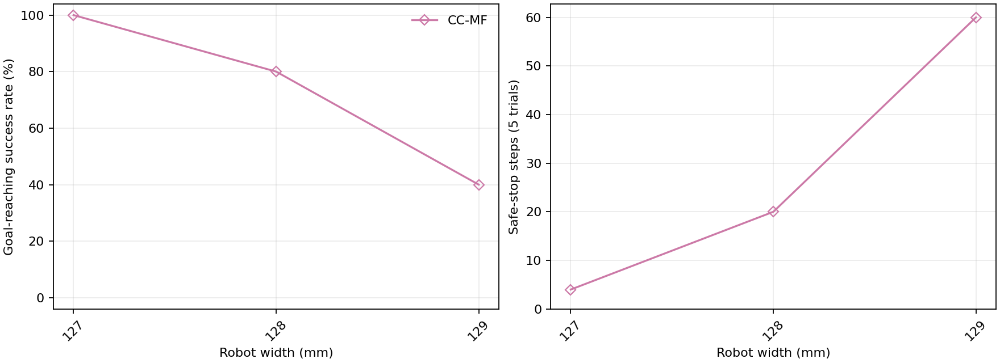

# Rectangle 너비별 주행 benchmark — CC-MF

실행일 2026-11-03 (KST). **15/15 trials 완료**.

maze / differential_drive (DD) / A*, rectangle 길이 0.150 m 고정. 너비 0.127, 0.128, 0.129 m의 3개 너비에서 CC-MF를 각 5회(seed 0–4) 같은 PC에서 순차 실행했다. Localization error는 끄고 animation은 생성하지 않았다.

설정은 `config/config_benchmark.yaml`의 현재 공통 조건을 사용했다. trial 제한 80 s, 이동 정체 창 10 s, 이동 임계값 0.03 m, 연속 실패 한도 20회다. 목표 위치 L1 오차 ≤0.02 m가 성공 판정이다. 접촉·겹침 자체는 별도 실패 조건이 아니다.

시작 자세에 x/y 표준편차 각각 0.02 m, heading 표준편차 0.05 rad, ±3σ의 Gaussian 교란을 적용했다. 모든 너비에서 초기 clearance ≥1 mm이며 같은 너비·seed의 방법들은 시작 자세가 같다. 과거 보고서의 일부 너비(≥10 mm)와 초기 여유 조건이 다르다.

컨트롤러는 실행 시작 시점의 코드를 고정하고 기본 파라미터를 사용했다. [앞선 실험](../rectangle_width070_130mm_step005_10trials_20261103/experiment.json)과 시뮬레이션 코드 및 해당 controller의 전체 파라미터가 동일한 것을 확인했다.

| Controller | d_min (mm) | a_max (m/s²) | r_delta_omega | σf / σl / σψ (m / m / rad) |
|---|---:|---:|---:|---|
| CC-MF | 0.1 | 0.3 | 0.1 | 0.0002 / 0.00025 / 0.00025 |

## 지표 정의

- Clearance: 초기 및 매 적분 후 실제 rectangle과 장애물의 정확한 polygon 거리, 지도 경계 margin 중 최솟값. 접촉·겹침은 0, 지도 경계 침범은 음수다. 성공·실패 trial의 전체 표본을 합쳐 mean/P05를 계산한다.
- Computation time: local reference 생성부터 controller 전처리·파라미터 갱신·solver·복구·내부 로깅까지의 제어 사이클 wall-clock 시간(perf_counter + CUDA 동기화). 각 trial 첫 사이클은 제외하고 이후 실패·fallback도 포함한다. 경로 계획·plant 적분·결과 저장은 제외한다. 전체 유효 step을 합쳐 mean/P95를 계산한다.
- Traversal time: 성공 trial의 시뮬레이션 시간 평균. 성공 0건은 —다.
- Safe stop: zero-input fallback 제어 step 합계(연속 정지도 매 step 집계). MPCC는 해당 fallback이 없어 0이다. 계측 유실 시 확인 가능한 하한을 ≥로 표시한다.

## 성공률

| Width (m) | CC-MF |
|---:|---:|
| 0.127 | 5/5 |
| 0.128 | 4/5 |
| 0.129 | 2/5 |

## 상세 결과

| Width (m) | Controller | 성공/완료 | Mean clearance (mm) | P05 clearance (mm) | Mean computation (ms/step) | P95 computation (ms/step) | Mean traversal (s) | Safe stop (step) |
|---:|---|---:|---:|---:|---:|---:|---:|---:|
| 0.127 | CC-MF | 5/5 | 3.276 | 0.492 | 43.817 | 70.835 | 55.66 | 4 |
| 0.128 | CC-MF | 4/5 | 3.056 | 0.513 | 37.118 | 55.319 | 54.35 | 20 |
| 0.129 | CC-MF | 2/5 | 2.709 | 0.375 | 36.689 | 56.435 | 56.45 | 60 |

## 실패 기록

목표 미도달 trial 4건. 성공률 분모에는 failure·timeout·error를 포함한다.

| Width (m) | Controller | Status | Failure reason | Count |
|---:|---|---|---|---:|
| 0.128 | CC-MF | failure | consecutive_unsuccessful_control_steps(20): safe_stop_stage0 | 1 |
| 0.129 | CC-MF | failure | consecutive_unsuccessful_control_steps(20): safe_stop_stage0 | 3 |

Trial별 실패 상세

| Width (m) | Controller | Seed | End time (s) | Failure reason |
|---:|---|---:|---:|---|
| 0.128 | CC-MF | 3 | 35.1 | consecutive_unsuccessful_control_steps(20): safe_stop_stage0 |
| 0.129 | CC-MF | 1 | 16.5 | consecutive_unsuccessful_control_steps(20): safe_stop_stage0 |
| 0.129 | CC-MF | 3 | 5.6 | consecutive_unsuccessful_control_steps(20): safe_stop_stage0 |
| 0.129 | CC-MF | 4 | 40.9 | consecutive_unsuccessful_control_steps(20): safe_stop_stage0 |

## 실행 자료

Python 3.10.13, PyTorch 2.4.1, CasADi 3.7.0, NVIDIA GeForce RTX 3060, Torch CPU threads 6.

[실행 조건·전체 파라미터](experiment.json) · [Trial 결과](trial_results.csv) · [3개 조합 집계](benchmark_summary.csv) · [검증 기록](report_integrity.json)
