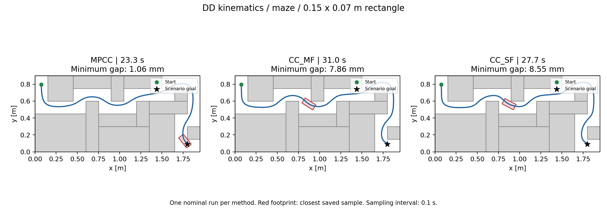

# MPCC 상속 리팩터링 실행 검증

실행일: 2026-10-19 (Asia/Seoul)

**MPCC, CC-MF, CC-SF 모두 목표에 도달했다.** CC-MF/SF의 동작 회귀는 이번 조건에서 재현되지 않았고, 알고리즘이나 튜닝 값을 추가 변경하지 않았다. 현재 누락되어 있던 deterministic `mpcc`의 CLI/factory·spline reference·CSV 로깅 연결을 추가했다.

## 조건과 환경

- DD kinematics, `maze`, `rectangle` 0.15×0.07 m, A* + Line of Sight.
- 동일한 시작 pose: `[0.075, 0.795, -pi/2]`. 시작 perturbation·localization error 비활성.
- 각 방법 1회씩 MPCC → CC-MF → CC-SF 순서로 실행. 최대 시뮬레이션 시간 60초, plant timestep 0.1초, horizon 20, prediction time 2초.
- 각 controller의 Python Param 기본값 사용. MF/SF는 현재 Log-Cholesky 표현, MF 기준 공통 alpha/beta, CUDA PSDF를 사용한다. 별도 controller YAML 튜닝 없음.
- 성공은 기존 판정인 **계획 경로의 마지막 waypoint에 대한 위치 L1 오차 ≤ 0.02 m**다. `distance_to_goal`도 이 정의이며 heading 조건은 추가하지 않았다.
- 실패 checker: 4초 동안 이동 ≤ 0.03 m 또는 20회 연속 실패. 이번 실행에서는 해당하지 않았다.
- Python 3.12.10, NumPy 1.26.4, SciPy 1.13.1, PyTorch 2.4.1+cu118, CasADi 3.7.1, CUDA runtime 11.8.
- WSL Ubuntu 20.04, GTX 1660 SUPER 6 GB, driver 591.86. 기존 Python 3.8 환경은 변경하지 않고 `/tmp/psdf_mpcc_validation_20261019`에 검증 환경을 만들었다.
- acados source: `fd231104913cc9c305e0dff736281b91dc1dbc5b`; 기존 로컬 라이브러리를 사용했다. `OMP_NUM_THREADS=1`, `OPENBLAS_NUM_THREADS=1`.
- controller 소스 기준은 리팩터링 커밋 `721e7578db89dbbc7ed4812dc80e91b1dddd3e88`이며, 이번 MPCC factory/로깅 추가를 포함한 실제 파일 hash는 [analysis.json](posthoc/analysis.json)에 저장했다.

## 주행 결과

| 방법 | 결과 | 도달시간 (simulated s) | 성공 solver 단계 / 전체 | 최종 L1 위치 오차 | 최소 실제 도형 간격 |
|---|---|---:|---:|---:|---:|
| MPCC | 성공 | 23.3 | 233 / 233 | 19.505 mm | 1.063 mm |
| CC-MF | 성공 | 31.0 | 310 / 310 | 19.947 mm | 7.861 mm |
| CC-SF | 성공 | 27.7 | 277 / 277 | 19.935 mm | 8.554 mm |

MF/SF의 backup 복구와 safe stop은 각각 **0회**다. 모든 저장된 controller status는 `0/success=True`이며 주행 데이터에서 NaN/Inf는 발견되지 않았다. MF의 Log-Cholesky covariance 진단 6,510행도 유한하다. MF slack의 빈 값은 OCP 안전 row가 없는 stage 0에만 있으며, 나머지 최대 slack은 약 `1.596e-10`이다.

최소 간격은 PSDF 로그만 사용하지 않고 **초기 pose 및 매 plant update 후 pose**를 다시 검사한 값이다. 실제 rectangle polygon과 모든 장애물의 Euclidean 거리 및 map boundary 간격을 계산했고, 정규화된 축의 SAT로 strict overlap도 별도 확인했다. 세 방법 모두 접촉·겹침 샘플은 0개였다. 원래 PSDF 로그의 최소값도 각각 1.063 / 7.861 / 8.554 mm로 일치한다.

이는 **각 방법 1회의 nominal 실행과 0.1초 간격의 저장 pose 검사**다. 제어 단계 사이의 연속 시간 충돌 자유나 무작위 초기 조건에 대한 성공률을 검증한 것은 아니다. 이번 조건에서 실패가 없어 과거 코드의 별도 주행 비교는 수행하지 않았다.



## 계산시간의 해석

`solver_times`는 기존 정의를 유지했다. MF는 acados `solve()` 호출만, MPCC/SF는 준비 작업과 일부 후처리까지 포함한다. 따라서 `current/summary.csv`의 solver 시간으로 방법 간 속도를 직접 비교하면 안 된다.

같은 `generate_control_input()` 전체 구간을 측정한 controller 시간은 다음과 같다. 첫 단계의 C 코드 생성·컴파일 및 초기화 비용을 제외한 2번째 이후 단계의 값이다.

| 방법 | controller 전체 median | controller 전체 p95 |
|---|---:|---:|
| MPCC | 31.90 ms | 42.83 ms |
| CC-MF | 33.25 ms | 44.86 ms |
| CC-SF | 48.17 ms | 63.36 ms |

첫 단계를 포함한 원시 값과 제외한 통계는 모두 `posthoc/analysis.json`에 보관한다. 해당 구간은 setup·PSDF 갱신·solve·recovery를 포함하며, 호출 이후의 controller logging과 plant update는 제외한다.

## 테스트 결과

- [focused_tests.log](focused_tests.log): 공통 MPCC·MF/SF·Log-Cholesky·DD·ECS 호환성·spline 관련 **101개 모두 통과**, skip 없음. 새 MPCC factory/CLI/상태 로깅 테스트도 포함한다.
- [unit_tests.log](unit_tests.log): 더 넓은 초기 검사 110개 중 107개 통과, 1개 skip, 2개 오류. `test_example_config_has_four_isolated_ecs_runs`는 기존 `config/config_nmpc_cc_ecs_rectangle_all4.yaml` 파일이 없었고, `test_erk_ocps_explicitly_select_one_classical_rk4_step`는 별도 PSDF optimizer의 `l4casadi`가 검증 환경에 설치되지 않아 실행하지 못했다. 이 두 검사까지 통과했다고 주장하지 않는다.
- 실제 주행 로그의 tensor 생성 성능 경고와 EXTERNAL cost/GAUSS_NEWTON 설정 경고는 기록해 두었다. 세 방법의 이번 주행에서는 solver 실패나 recovery가 발생하지 않았다.

## 재현과 원시 자료

패키지 목록은 [requirements-validation.txt](requirements-validation.txt), 실험 설정은 [전용 YAML](../../config/config_mpcc_refactor_validation.yaml), 실제 입력은 [run_manifest.yaml](current/run_manifest.yaml)에 있다. acados는 기존 설치의 소스·컴파일 라이브러리를 사용해야 한다. CUDA 사용이 가능해야 한다.

프로젝트 루트에서 환경을 활성화하고 acados 경로를 실제 설치에 맞춘 뒤 실행한다. 기존 결과를 덮어쓰지 않도록 새 결과 디렉터리를 지정한다.

```bash
export MPLBACKEND=Agg
export ACADOS_SOURCE_DIR=/path/to/acados
export PYTHONPATH="$ACADOS_SOURCE_DIR/interfaces/acados_template${PYTHONPATH:+:$PYTHONPATH}"
export LD_LIBRARY_PATH="$ACADOS_SOURCE_DIR/lib${LD_LIBRARY_PATH:+:$LD_LIBRARY_PATH}"
export OMP_NUM_THREADS=1 OPENBLAS_NUM_THREADS=1

python test_nmpc.py -c config/config_mpcc_refactor_validation.yaml \
  --trials 1 --results-dir benchmark_runs/mpcc_override_rerun_01

python benchmark_runs/mpcc_refactor_validation_20261019/analyze.py \
  --results-dir benchmark_runs/mpcc_override_rerun_01 \
  --output-dir benchmark_runs/mpcc_override_rerun_01/posthoc
```

- [trial_results.csv](current/trial_results.csv): 목표 판정과 시뮬레이션 도달시간.
- [summary.csv](current/summary.csv): 기존 방식별 solver 시간 통계.
- `current/runs/config01..03/trial_0001/data/`: 실제 pose/control/status, PSDF, MF covariance/cycle 원시 CSV.
- [current.log](current.log): 코드 생성·컴파일 및 전체 주행 로그.
- [analysis.json](posthoc/analysis.json), `posthoc/*_clearances.csv`: 입력 hash·환경·도형 간격·겹침·시간 통계.
- [analyze.py](analyze.py): 저장 CSV의 사후 검사와 궤적 그림 생성. optimizer나 solver를 생성하지 않는다.
