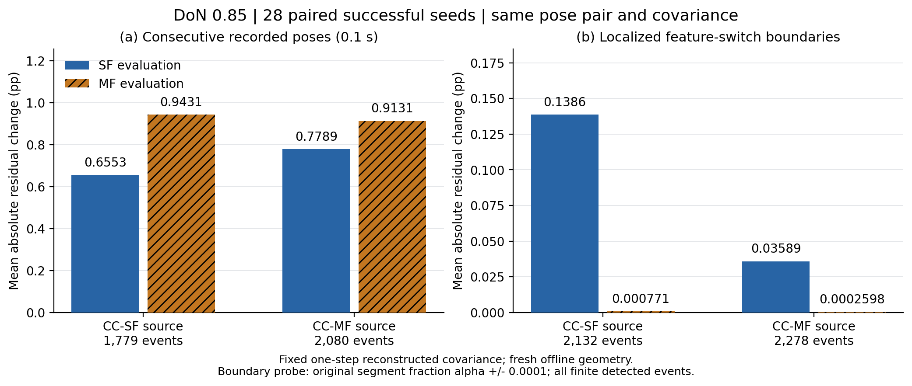
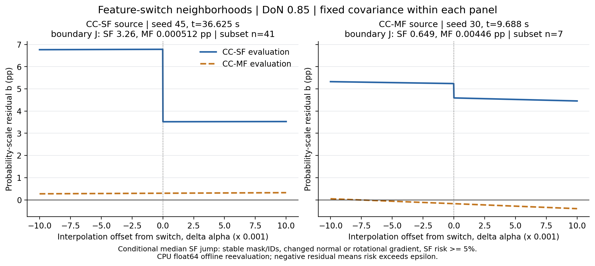
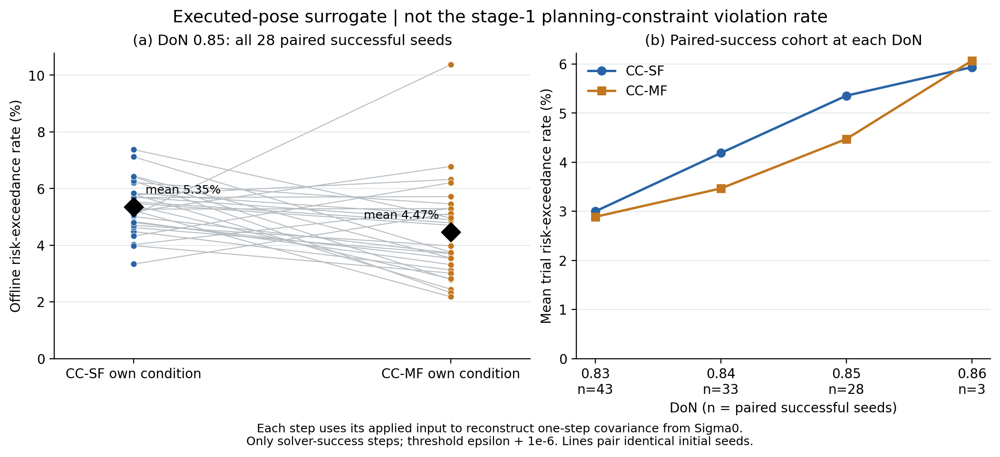

# CC-SF / CC-MF constraint reliability — 저장된 주행자료의 평가

분석일: 2026-11-07. 대상은 기존 보고서가 사용한 **2026-11-05 current-SF DoN sweep**이다. 새 solver·simulation·benchmark를 실행하지 않았고 원본 trial·trace·보고서는 변경하지 않았다.

**권장 구성:** DoN 0.85의 공통 성공 28 seeds로 feature-switching sensitivity figure를 사용한다. 국소 boundary probe에서 MF residual의 평균 변화가 SF보다 작다. 그러나 **6.3-B에 정의된 정상 solve의 stage-1 chance-constraint violation rate는 이 raw trace에 필요한 값이 없어 계산 불가**다. 아래 실제 주행 자세 기반 위험 초과율을 그 지표로 대신 표기하면 안 된다.

## 1. 사용할 cohort와 근거

| DoN | 너비 mm | SF 성공/50 | MF 성공/50 | 공통 성공 seed |
| --- | --- | --- | --- | --- |
| 0.83 | 124.5 | 47 | 46 | 43 |
| 0.84 | 126 | 34 | 49 | 33 |
| 0.85 | 127.5 | 32 | 45 | 28 |
| 0.86 | 129 | 4 | 20 | 3 |

DoN 0.85는 SF 32/50, MF 45/50 성공이며 두 방법이 모두 성공한 seed가 28개다. 0.86은 공통 성공 3개뿐이므로 주 자료로 쓰기에는 표본이 작다. 0.85의 paired seeds는 `1 3 4 7 8 9 12 14 15 17 19 25 27 28 29 30 32 33 35 36 40 41 43 44 45 46 47 49`다. 같은 너비·seed의 시작 pose가 일치한다. 성공 여부에 따른 선택이 있으므로 이하 결과는 **두 방법 모두 성공한 조건부 cohort**에 대한 설명이다.

원본은 `../rectangle_don_sweep_50_20261105_current_sf`다. config ID를 원본 CSV로 확인했으며 `config03=CC-SF`, `config04=CC-MF`다. DoN 0.83–0.86의 두 방법 총 400 traces를 점검했고 NPZ/metadata 누락·hash 불일치·비유한 수·길이/결과 불일치는 없었다. 그중 공통 성공 107 seed pairs, 총 214 traces를 수치 분석했다. [가용성 audit](audit/raw_availability.json), [cohort CSV](tables/paired_cohort.csv).

## 2. Feature-switching sensitivity figure



Source trajectory는 실제 CC-SF 또는 CC-MF 주행이다. **각 source의 동일 pose pair에 SF와 MF 수식을 모두 적용**했다. 막대 색은 주행 controller가 아니라 평가 formulation이다. 따라서 서로 다른 경로의 jump 크기를 곧바로 formulation 차이라고 해석하지 않는다.

$$b_{SF}=\varepsilon-\Phi((d_{min}-\phi_\star)/\sigma_\star),\qquad b_{MF}=\varepsilon-\sum_i\Phi((d_{min}-d_i)/\sigma_i),$$
$$\sigma_i^2=q_i^T\Sigma q_i,\qquad J_M=100|b_M^+-b_M^-|\quad[\mathrm{pp}].$$

여기서 ε=0.1, d_min=0.0001 m다. **MF의 R=Σp_i는 Boole sum이며 실제 충돌확률 자체가 아니고 1을 초과할 수도 있다.** Slack, QP row residual, solver failure를 위 수치로 대체하지 않았다.

| 평가 요소 | 이번 자료의 정의 |
| --- | --- |
| Pose | raw trace의 실제 초기/적분 후 자세; solver candidate가 아님 |
| 고정 covariance | 각 step의 Σ0에서 저장된 적용 입력으로 0.1 s 한 번 전파한 Σ1; 같은 pair와 SF/MF 모두에 동일하게 고정 |
| Σ0 | 당시 설정 σ_f0=0.0002 m, σ_l0=0.00025 m, σ_ψ0=0.00025 rad; 각 step에서 다시 초기화 |
| 전환 검출 | endpoint의 canonical feature ID 변화; 동일 endpoint alias를 기존 helper로 통합 |
| 0.1 s panel | 전환이 검출된 실제 연속 pose 사이의 변화; 실제 이동 효과가 포함됨 |
| 국소 panel | 각 segment 9점에서 관측된 ID 변화를 26회 이분법으로 좁힌 뒤 α±10⁻⁴에서 평가 |
| Geometry | 실행 source snapshot, CPU float64 재평가; 원 실행 CUDA float32와 구분 |
| 집계 | 원래 solver-success step에서 검출된 모든 finite event의 단순 평균; source별 사건 수를 표시 |

**저장된 planning covariance를 사용한 정확한 재현은 아니다.** 미래 입력 sequence를 임의로 만들어 stage 10을 흉내 내지 않고, trace에 근거가 있는 한 step reconstruction으로 범위를 한정했다. 연속 구간 안에서 전환 후 원래 ID로 되돌아오는 사건은 endpoint 검출에서 누락될 수 있고, 9점보다 좁은 복수 전환도 놓칠 수 있다. 따라서 모든 연속시간 switching 사건의 전수 통계가 아니다.

| Source trajectory | 전환 경계 n | SF mean / median J (pp) | MF mean / median J (pp) | mean SF/MF |
| --- | --- | --- | --- | --- |
| CC-SF | 2132 | 0.138593 / 4.73908e-05 | 0.000771 / 3.23575e-07 | 179.7× |
| CC-MF | 2278 | 0.035894 / 2.53009e-08 | 0.000260 / 1.12607e-10 | 138.2× |

**0.1초 pose 변화 전체에서는 방향이 다르다.** CC-SF source에서 평균 J는 SF 0.6553 pp / MF 0.9431 pp, CC-MF source에서 SF 0.7789 pp / MF 0.9131 pp로 MF가 더 크다. 따라서 “MF가 주행 중 모든 residual 변동을 줄인다”는 주장은 지지되지 않는다. **국소 switching 경계의 변화가 작다**는 결과와 유한한 이동 중 residual 기울기의 크기는 구분한다.

Mean과 median의 차이가 크므로 모든 전환에서 큰 jump가 발생한다고 말할 수 없다. 위 표는 event 가중이며 trial 균등 평균과 다르다. 작은 값은 0으로 반올림해 숨기지 않고 CSV에 유지했다. Local probe에서 side ID가 예상 bracket과 다른 사건 61개, feature mask가 바뀐 사건 0개도 주 집계에서 임의로 제거하지 않았다. ID가 안정적이고 mask가 유지되며 φ>d_min인 subset의 결과는 [summary CSV](tables/paired_summary.csv)에 별도 보존했다.

### 국소 probe 폭의 영향

| Source | probe ±Δα | SF mean J (pp) | MF mean J (pp) |
| --- | --- | --- | --- |
| CC-MF | 0.0001 | 0.035894 | 0.000260 |
| CC-MF | 0.001 | 0.036787 | 0.002613 |
| CC-SF | 0.0001 | 0.138593 | 0.000771 |
| CC-SF | 0.001 | 0.141332 | 0.007747 |

Probe 폭을 줄일 때 MF의 변화가 함께 줄어드는지, SF의 유한 변화가 남는지를 비교한다. 유한한 sampling 결과이며 모든 geometry에서의 연속성 정리나 solver infeasibility의 인과 증명은 아니다. 같은 probe의 float32 재평가에서도 방향은 유지되지만 SF mean은 float64 대비 약 15% 작아졌다. 정확한 수치 크기는 precision과 경계 localization에 민감하다. [probe convergence CSV](tables/probe_convergence.csv)에 두 precision을 남겼다.

### 논문용 확대 사례



| Source | subset n | seed | 시각 s | SF J pp | MF J pp |
| --- | --- | --- | --- | --- | --- |
| CC-SF | 41 | 45 | 36.6247 | 3.2614 | 0.00051178 |
| CC-MF | 7 | 30 | 9.6885 | 0.6489 | 0.0044586 |

사례는 source별 stable-ID boundary 중 **위험이 무시할 정도로 작지 않은 전환 subset에서 SF J의 median에 가장 가까운 사건**을 고른 것이다. Subset은 stable ID, unchanged mask, φ>d_min, translation normal 변화 >0.1 또는 heading-gradient 변화 >0.001 m, 양쪽 중 최대 SF risk≥0.05로 정의했다. 이 조건 안의 중앙 사례이며 전체 사건의 median이나 무작위 표본은 아니다. 전체 사건 집계와 함께 사용한다. 각 panel에서 pose와 covariance는 SF/MF가 동일하다. [선택된 좌표·공분산·feature ID](tables/selected_boundary_examples.csv), [전체 사건](tables/switch_events.csv).

**선택 사례의 precision 한계도 중요하다.** SF source seed 45의 위 그림은 float64 경계다. 동일한 매우 좁은 두 probe를 float32로 평가하면 SF J는 3.2614 pp가 아니라 0.001284 pp여서 그 경계 jump를 포착하지 못한다(MF 0.001584 pp). 반면 MF source seed 30에서는 float32 SF J=0.64866 pp로 float64 결과와 가깝다. 이는 precision에 따른 전환 위치 이동을 보여주며, seed 45 그림을 원 CUDA 주행에서 관측된 같은 시점의 jump로 설명하면 안 된다. 전체 event 집계의 차이 방향은 유지된다.

**그림 캡션 초안:** “Feature-switching sensitivity at DoN=0.85 over 28 paired successful seeds. Both formulations are reevaluated at identical pose pairs with a fixed, one-step reconstructed body-frame covariance. Bars show mean absolute probability-scale residual changes; illustrative local profiles are selected near the median SF jump within a disclosed subset of normal-changing, non-negligible-risk events. These are offline evaluations of executed trajectories, not logged optimizer residuals.”

## 3. 요청한 chance-constraint violation rate의 가용성

6.3-B의 원래 지표는 정상 solve가 반환한 stage-1 candidate x*₁과 해당 계획 상태의 Σ*₁에서 geometry를 새로 평가해 `p* > ε + τ` 또는 `R > ε + τ`를 세는 것이다. MF slack을 반영하지 않고 row가 disabled되어도 평가 가능한 candidate를 포함해야 한다.

현재 NPZ에는 `poses`, `pose_times_s`, `applied_inputs`, `solve_nlp_times_s` 네 배열만 있다. Metadata에는 solver status가 있으나 **x*₁, Σ*₁, per-call solve mode, horizon trajectory가 없다.** 실제 다음 자세와 적용 입력으로 covariance를 전파해도 SQP-RTI가 반환한 최적화 상태의 선형화 defect까지 복원할 수 없다.

| 요청 지표 | CC-SF | CC-MF |
| --- | --- | --- |
| 정상 solve stage-1 자체 unrelaxed chance-constraint violation rate | 미계측 / 산출 불가 | 미계측 / 산출 불가 |

미계측을 0%로 채우지 않았다. 과거 2026-11-03의 상세 checkpoint는 현재 SF와 다른 formulation이므로 이번 benchmark의 근거로 합치지 않았다. 주행 성공, solver 성공, 실제 접촉, planning chance-condition 만족은 각각 다른 사건이다.

## 4. 참고: 실제 주행 자세의 offline risk-exceedance



이 그림의 지표는 **executed-pose risk-exceedance surrogate**다. 원래 위반율 figure의 대체물로 사용하지 않는다. 각 적분 후 pose에서 해당 controller 자신의 SF 또는 MF condition을 평가했다. Initial pose는 분모에서 제외하고, `success=true` 및 `solver_called=true`인 step만 포함했다. backup solver는 꺼져 있다. 공통 tolerance τ=10⁻⁶ probability units를 사용했다. Missing/invalid를 0으로 바꾸지 않았다.

| DoN | paired n | SF trial-mean % | MF trial-mean % | SF pooled 위반/유효 step | MF pooled 위반/유효 step |
| --- | --- | --- | --- | --- | --- |
| 0.83 | 43 | 2.997 | 2.886 | 612/20475 | 628/21494 |
| 0.84 | 33 | 4.186 | 3.465 | 697/16670 | 590/16711 |
| 0.85 | 28 | 5.353 | 4.471 | 787/14651 | 701/15458 |
| 0.86 | 3 | 5.934 | 6.066 | 100/1696 | 106/1729 |

Trial-mean은 seed마다 같은 가중치, pooled 값은 step 가중치다. SF와 MF는 다른 condition을 평가하므로 값 자체가 같은 물리적 충돌률을 뜻하지 않는다. 특히 같은 pose에서는 복수 feature의 sum이 단일 feature보다 엄격해질 수 있다.

DoN 0.85에서 SF trial-mean은 **5.353%**, MF는 **4.471%**다. 이 보조 지표의 평균 초과율은 SF가 더 높았다. 이는 native stage-1 위반율의 차이를 뜻하지 않는다. SF−MF paired mean 차이는 +0.882 pp이며, paired seed 단위 20,000회 bootstrap의 탐색적 95% percentile interval은 [+0.123, +1.600] pp다. 시간 상관이 있는 step을 독립 이항표본으로 취급하지 않았다. 이 구간은 성공 조건부 cohort의 보조 지표에만 해당한다.

28 pairs 중 SF rate가 더 큰 seed는 20개, MF가 더 큰 seed는 8개, 같은 seed는 0개다. DoN 및 사례 선택 이후의 탐색적 결과이며 확증적 유의성 주장으로 쓰지 않는다. 비교한 214 traces에서 solver 비성공/미호출로 제외한 step은 100개, finite risk를 계산할 수 없는 eligible step은 0개다.

### 특정 성공 trial의 비교 후보

아래는 DoN 0.85에서 **SF−MF 보조지표 차이가 큰 순서의 상위 3개**다. 선택 기준을 공개하기 위한 후보 목록이며 전체 경향의 증거로 단독 사용하지 않는다. **이 숫자로 native chance-constraint violation rate가 SF에서 더 높다고 주장할 수 없다.**

| seed | SF surrogate % | MF surrogate % | SF−MF pp |
| --- | --- | --- | --- |
| 19 | 6.272 | 2.317 | +3.956 |
| 32 | 6.415 | 2.783 | +3.632 |
| 45 | 7.119 | 3.750 | +3.369 |

[모든 28 seed의 차이](tables/don085_paired_trial_rate_differences.csv), [모든 DoN·trial의 분자/분모](tables/per_trial_metrics.csv).

## 5. 6.3-B에 넣을 수 있는 결론과 추가 계측

현재 자료가 뒷받침하는 문장은 다음과 같다.

> DoN 0.85에서 두 controller가 모두 성공한 동일 seed 집합의 실제 궤적을 사용하여, 동일 pose pair 및 고정된 한 step 재구성 공분산에서 SF와 MF를 교차 평가했다. 검출된 feature-switching 경계에서 MF probability-scale residual의 평균 국소 변화가 SF보다 작았다. 이 결과는 formulation의 국소 민감도에 관한 오프라인 증거이며, 저장되지 않은 stage-1 계획의 chance-constraint 위반율이나 solver 실패의 인과를 입증하지 않는다.

원 문서의 “CC-SF의 주요 충돌 원인은 …”, “이로 인한 infeasible status가 적음”은 이 자료로 확정할 수 없다. 목표 미도달의 주 원인으로 기록된 stage-0 guard stop을 실제 충돌로 부르지 않는다. 원래 violation rate 차이를 논문에 넣으려면 새 진단 자료가 필요하다.

필요한 최소 per-cycle 기록은 아래와 같다. 별도 주행은 실행하지 않았다.

- `trial_id, seed, step, time, solver_called, status_code, solve_mode`; main/backup/safe-stop을 구분한다.
- 정상 solve 반환 직후의 `x_candidate[1,:8]` (pose, progress, reduced log-Cholesky covariance), candidate 가용성 및 capture 실패 사유.
- geometry/ROI snapshot 식별자, 당시 ε·d_min·feature masking 설정. 재평가 시 필요한 obstacle edges를 복원 가능하게 한다.
- MF slack과 row-enabled flag는 별도 진단으로만 보관하며 unrelaxed condition의 판정에 넣지 않는다.
- 같은 tolerance τ와 denominator를 적용하고 정상 candidate 중 disabled row도 포함한다. 무효 candidate는 제외 수와 원인을 별도로 보고한다.

권장 추가 cohort는 DoN 0.85, 기존 동일 seed 0–49, 두 방법이다. 성공-only paired subset뿐 아니라 전체 정상 candidate cohort도 함께 보고해야 성공 조건부 선택을 분리할 수 있다. 신규 계측 run의 source/hash와 timing cohort는 기존 benchmark와 구분한다.

## 6. 재현과 파일

실행 source snapshot aggregate SHA-256: `18377821b243cfbac53a14ad151b8195dc659e29d2cfe6655fe8592ed30091d6`. 계산에는 해당 snapshot의 geometry와 covariance 함수를 사용했다. 현재 controller 코드는 수정하지 않았다. 원래 보고서 텍스트 일부에 중복/혼입된 문장이 보여 숫자는 원본 CSV·metadata로 재확인했으며 원 보고서는 보존했다.

```powershell
$env:PYTHONPATH='C:/Users/taek111/.cache/codex-runtimes/psdf-analysis-torch'
python -B scripts/analyze_sf_mf_reliability.py --dons 0.85 0.83 0.84 0.86
python -B scripts/render_sf_mf_reliability.py
python -B scripts/write_sf_mf_reliability_report.py
```

분석용 CPU PyTorch 2.4.1은 별도 cache 경로에 설치했다. 기존 environment의 torch를 교체하지 않았다. 다른 PC에서는 NumPy/Pandas/Matplotlib/PyTorch/PyYAML가 있는 환경에서 같은 script를 사용하면 된다. Geometry dtype/CPU와 원 CUDA 실행의 차이는 원래 solver residual의 정확한 복제라는 해석을 막는 추가 이유다.

- [PNG / PDF / SVG figure 폴더](figures/), [재현·소스 hash manifest](audit/analysis_manifest.json).
- [분석 코드](../../scripts/analyze_sf_mf_reliability.py), [그림 코드](../../scripts/render_sf_mf_reliability.py), [보고서 생성 코드](../../scripts/write_sf_mf_reliability_report.py).
- [원자료 가용성 audit](audit/raw_availability.json), [독립 검토](audit/review.json), [paired 보조지표 비교](audit/paired_surrogate_comparison.json).
