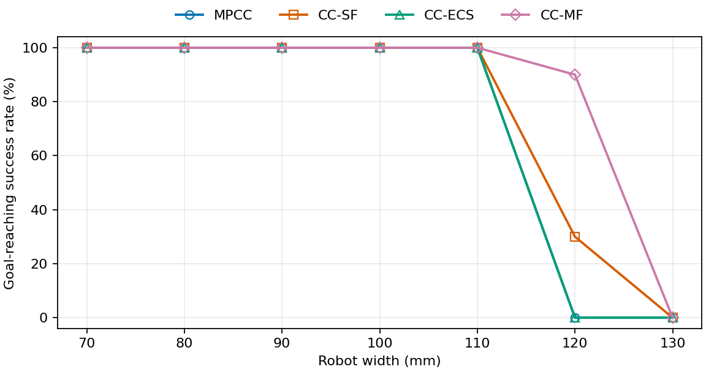

# Deadlock tuning width benchmark

## Deadlock tuning 적용: robot width 0.070–0.130m, 각 10 trials

- 실행일: 2026-10-30 (KST). 완료: **280/280 trials**. Rectangle 길이 0.150m, maze, DD, A*. 같은 PC에서 순차 실행했다.
- MPCC 공통 기본값: **vmin=-1.0m/s, vmax=1.0m/s, v_s_target=1.0m/s, omegamin=-1.0rad/s, omegamax=1.0rad/s, a_max=0.5m/s², alpha_max=5.0rad/s²**. CC-SF·CC-ECS·CC-MF가 이 값을 상속한다.
- 폭 0.070/0.080/0.090/0.100/0.110/0.120/0.130m × 네 controller × seed 0–9, 조합별 10회다. x/y 표준편차 0.02m, heading 표준편차 0.05rad, ±3σ 제한, 초기 clearance는 **0.070–0.120m에서 ≥10mm, 0.130m에서만 ≥1mm**다. 폭 0.130m는 0.150m 시작 통로에서 10mm 여유와 무작위 자세 교란을 동시에 만족할 수 없어 사용자 지정으로 완화했다. 같은 폭·seed에서 시작 자세가 동일하다. Localization error는 끈다.
- 이번 실행은 위의 과거 실험과 달리 **현재 controller 기본 불확실성**을 유지했다. CC-SF·CC-MF: (σf,σl,σψ)=(0.0002m,0.00025m,0.000025rad), covariance_growth_scale=0.8. CC-ECS: (0.0002m,0.00025m,0.00025rad), process noise=0. d_min은 MPCC·CC-SF·CC-ECS 1mm, CC-MF 0.2mm이며, r_delta_v=r_delta_omega=0.05다. 과거 표와 tuning만 다른 통제 비교로 해석할 수 없다.
- dt=0.1s, horizon=20, trial 제한 60s. 목표 위치 L1 오차 ≤ 0.02m이면 성공이다. 4초 동안 위치 변화 ≤ 0.03m 또는 solver 연속 20회 실패면 실패다. 접촉·겹침 자체는 별도 실패 조건이 아니다.
- Success Rate는 성공/완료 trial이며 timeout·failure·error도 분모에 포함한다. Mean Traversal time은 성공 trial만의 평균이다. Mean/P05 clearance는 초기 자세와 매 적분 후 실제 rectangle의 정확한 polygon 거리 및 지도 경계 margin 중 최솟값을 전체 성공·실패 trial에 걸쳐 합쳐 계산한다. 접촉·겹침은 0, 지도 경계 침범은 음수다.
- Mean/P95 computation time은 local reference 생성부터 controller 전처리·solver·복구·내부 로깅까지 한 사이클의 wall-clock 시간이다. perf_counter와 CUDA 동기화를 사용하며 각 trial의 첫 사이클을 제외한다. 이후 실패·safe stop step도 모두 포함한다. Global path·plant 적분·파일 및 animation 저장은 제외한다. 평균과 분위수는 전체 유효 step을 합쳐 계산하며 trial별 통계의 평균이 아니다.
- Safe stop은 zero-input fallback step의 합계다. MPCC에는 이 fallback이 없어 0으로 표시한다. 계측 누락이 있으면 확인된 하한에 ≥를 붙인다.
- Animation은 기존 animate_world()/FFMpegWriter로 animations/<controller>/에 저장한다. 10fps, 100 DPI, libx264 ultrafast/CRF28이며 별도 재인코딩은 하지 않는다. 처음 4개는 모든 frame, 이후는 test_nmpc.py 기본값 frame_skip=5다.
- 실행 환경: Python 3.10.13, PyTorch 2.4.1, CasADi 3.7.0, NVIDIA GeForce RTX 3060, Torch CPU thread 6개.
- [실행 원본·설정](experiment.json), [trial 결과](trial_results.csv), [폭별 집계](benchmark_summary.csv), [animation 목록](animation_index.md).

저장 영상 280개 중 278개는 원래 trial 종료까지의 영상이다. Native crash trial은 원본 checkpoint 부분 영상 1개와 동일 조건·seed의 별도 재실행 부분 영상 1개로 구분했다. 재실행은 위 280회 집계에 추가하지 않았다.

네 controller가 모두 10/10 성공한 폭은 0.070m, 0.080m, 0.090m, 0.100m, 0.110m다.

폭 0.130m의 성공 횟수는 MPCC 0/10, CC-SF 0/10, CC-ECS 0/10, CC-MF 0/10이다.

### Robot width 0.070m — deadlock tuning

| Controller | Success Rate | Mean clearance (mm) | P05 clearance (mm) | Mean computation time (ms/step) | P95 computation time (ms/step) | Mean Traversal time (s) | Safe stop (회) |
|---|---:|---:|---:|---:|---:|---:|---:|
| MPCC | 100% (10/10) | 8.896 | 1.594 | 27.305 | 35.805 | 22.94 | 0 |
| CC-SF | 100% (10/10) | 11.926 | 3.108 | 32.453 | 43.944 | 24.43 | 0 |
| CC-ECS | 100% (10/10) | 9.852 | 2.406 | 30.366 | 37.590 | 24.38 | 0 |
| CC-MF | 100% (10/10) | 11.483 | 2.410 | 32.472 | 45.393 | 26.34 | 0 |

**실패 trial**

없음.

### Robot width 0.080m — deadlock tuning

| Controller | Success Rate | Mean clearance (mm) | P05 clearance (mm) | Mean computation time (ms/step) | P95 computation time (ms/step) | Mean Traversal time (s) | Safe stop (회) |
|---|---:|---:|---:|---:|---:|---:|---:|
| MPCC | 100% (10/10) | 8.930 | 1.630 | 27.056 | 34.318 | 23.92 | 0 |
| CC-SF | 100% (10/10) | 11.648 | 2.892 | 31.566 | 42.139 | 25.74 | 0 |
| CC-ECS | 100% (10/10) | 9.791 | 2.395 | 30.176 | 35.938 | 25.65 | 0 |
| CC-MF | 100% (10/10) | 10.938 | 2.238 | 31.713 | 41.277 | 28.79 | 0 |

**실패 trial**

없음.

### Robot width 0.090m — deadlock tuning

| Controller | Success Rate | Mean clearance (mm) | P05 clearance (mm) | Mean computation time (ms/step) | P95 computation time (ms/step) | Mean Traversal time (s) | Safe stop (회) |
|---|---:|---:|---:|---:|---:|---:|---:|
| MPCC | 100% (10/10) | 8.588 | 1.479 | 28.988 | 44.807 | 25.50 | 0 |
| CC-SF | 100% (10/10) | 10.724 | 2.628 | 30.993 | 40.887 | 27.44 | 0 |
| CC-ECS | 100% (10/10) | 9.359 | 2.356 | 31.117 | 41.466 | 27.27 | 0 |
| CC-MF | 100% (10/10) | 9.974 | 2.018 | 34.992 | 56.929 | 31.82 | 0 |

**실패 trial**

없음.

### Robot width 0.100m — deadlock tuning

| Controller | Success Rate | Mean clearance (mm) | P05 clearance (mm) | Mean computation time (ms/step) | P95 computation time (ms/step) | Mean Traversal time (s) | Safe stop (회) |
|---|---:|---:|---:|---:|---:|---:|---:|
| MPCC | 100% (10/10) | 7.430 | 1.321 | 27.296 | 36.293 | 26.55 | 0 |
| CC-SF | 100% (10/10) | 8.529 | 2.469 | 31.093 | 40.820 | 29.98 | 0 |
| CC-ECS | 100% (10/10) | 8.170 | 2.056 | 30.126 | 35.184 | 29.18 | 0 |
| CC-MF | 100% (10/10) | 7.948 | 1.812 | 32.842 | 43.251 | 34.45 | 0 |

**실패 trial**

없음.

### Robot width 0.110m — deadlock tuning

| Controller | Success Rate | Mean clearance (mm) | P05 clearance (mm) | Mean computation time (ms/step) | P95 computation time (ms/step) | Mean Traversal time (s) | Safe stop (회) |
|---|---:|---:|---:|---:|---:|---:|---:|
| MPCC | 100% (10/10) | 5.058 | 1.134 | 27.548 | 36.867 | 29.18 | 0 |
| CC-SF | 100% (10/10) | 6.303 | 2.310 | 31.286 | 41.060 | 33.93 | 0 |
| CC-ECS | 100% (10/10) | 5.390 | 1.983 | 30.887 | 37.979 | 37.27 | 0 |
| CC-MF | 100% (10/10) | 6.205 | 1.630 | 32.791 | 42.589 | 39.55 | 0 |

**실패 trial**

없음.

### Robot width 0.120m — deadlock tuning

| Controller | Success Rate | Mean clearance (mm) | P05 clearance (mm) | Mean computation time (ms/step) | P95 computation time (ms/step) | Mean Traversal time (s) | Safe stop (회) |
|---|---:|---:|---:|---:|---:|---:|---:|
| MPCC | 0% (0/10) | -1.524 | -47.121 | 27.498 | 37.655 | — | 0 |
| CC-SF | 30% (3/10) | 4.868 | 0.692 | 38.093 | 131.626 | 40.87 | ≥124 |
| CC-ECS | 0% (0/10) | 4.245 | 1.897 | 29.454 | 35.764 | — | 0 |
| CC-MF | 90% (9/10) | 4.865 | 1.246 | 32.584 | 42.602 | 41.79 | 2 |

음수 clearance는 실제 footprint의 지도 경계 침범을 뜻한다. 해당 값과 실패 중의 모든 적분 후 자세도 집계에 포함했다.

**실패 trial**

| Controller | Trial (seed) | 종료 시간 (s) | 실패 사유 |
|---|---:|---:|---|
| MPCC | 1 (0) | 9.9 | consecutive_solver_failures(20): failure |
| CC-SF | 1 (0) | 14.2 | consecutive_solver_failures(20): failure |
| CC-ECS | 1 (0) | 11.1 | stuck_for_4.00s_disp_0.0299m_le_0.0300m |
| CC-SF | 2 (1) | — | Native crash (SIGSEGV, exit -11); step 계측 저장 전 종료 |
| CC-ECS | 2 (1) | 11.0 | stuck_for_4.00s_disp_0.0287m_le_0.0300m |
| MPCC | 2 (1) | 9.9 | consecutive_solver_failures(20): failure |
| CC-ECS | 3 (2) | 11.3 | stuck_for_4.00s_disp_0.0286m_le_0.0300m |
| MPCC | 3 (2) | 10.0 | consecutive_solver_failures(20): failure |
| MPCC | 4 (3) | 14.0 | stuck_for_4.00s_disp_0.0287m_le_0.0300m |
| CC-SF | 4 (3) | 17.6 | consecutive_solver_failures(20): failure |
| CC-ECS | 4 (3) | 11.1 | stuck_for_4.00s_disp_0.0299m_le_0.0300m |
| MPCC | 5 (4) | 8.2 | consecutive_solver_failures(20): failure |
| CC-SF | 5 (4) | 14.3 | consecutive_solver_failures(20): failure |
| CC-ECS | 5 (4) | 11.2 | stuck_for_4.00s_disp_0.0289m_le_0.0300m |
| CC-SF | 6 (5) | 14.7 | consecutive_solver_failures(20): failure |
| CC-ECS | 6 (5) | 11.1 | stuck_for_4.00s_disp_0.0287m_le_0.0300m |
| MPCC | 6 (5) | 10.0 | consecutive_solver_failures(20): failure |
| CC-ECS | 7 (6) | 11.0 | stuck_for_4.00s_disp_0.0287m_le_0.0300m |
| MPCC | 7 (6) | 9.9 | consecutive_solver_failures(20): failure |
| CC-SF | 7 (6) | — | Native crash (SIGSEGV, exit -11); step 계측 저장 전 종료 |
| MPCC | 8 (7) | 8.2 | consecutive_solver_failures(20): failure |
| CC-SF | 8 (7) | 17.0 | consecutive_solver_failures(20): failure |
| CC-ECS | 8 (7) | 11.3 | stuck_for_4.00s_disp_0.0289m_le_0.0300m |
| MPCC | 9 (8) | 9.9 | consecutive_solver_failures(20): failure |
| CC-ECS | 9 (8) | 11.2 | stuck_for_4.00s_disp_0.0286m_le_0.0300m |
| CC-ECS | 10 (9) | 21.1 | stuck_for_4.00s_disp_0.0290m_le_0.0300m |
| CC-MF | 10 (9) | 12.0 | stuck_for_4.00s_disp_0.0289m_le_0.0300m |
| MPCC | 10 (9) | 9.9 | consecutive_solver_failures(20): failure |

Native crash로 종료한 trial도 성공률 분모에 포함했다. 해당 trial의 clearance·계산 시간·종료 시각은 저장되지 않아 다른 지표에서 제외했다. 부분 영상은 checkpoint 또는 동일 설정·seed의 별도 재실행으로 만들었으며, 재실행 영상은 원래 trial의 유실된 궤적을 증명하지 않는다. Animation 목록에 partial checkpoint/replay를 구분했다.

### Robot width 0.130m — deadlock tuning

| Controller | Success Rate | Mean clearance (mm) | P05 clearance (mm) | Mean computation time (ms/step) | P95 computation time (ms/step) | Mean Traversal time (s) | Safe stop (회) |
|---|---:|---:|---:|---:|---:|---:|---:|
| MPCC | 0% (0/10) | 0.954 | 0.000 | 26.502 | 32.470 | — | 0 |
| CC-SF | 0% (0/10) | 2.564 | 0.083 | 77.578 | 149.598 | — | 179 |
| CC-ECS | 0% (0/10) | 2.780 | 1.796 | 29.836 | 37.017 | — | 0 |
| CC-MF | 0% (0/10) | 1.601 | -1.966 | 32.297 | 44.271 | — | 177 |

음수 clearance는 실제 footprint의 지도 경계 침범을 뜻한다. 해당 값과 실패 중의 모든 적분 후 자세도 집계에 포함했다.

**실패 trial**

| Controller | Trial (seed) | 종료 시간 (s) | 실패 사유 |
|---|---:|---:|---|
| MPCC | 1 (0) | 10.9 | consecutive_solver_failures(20): failure |
| CC-SF | 1 (0) | 5.5 | stuck_for_4.00s_disp_0.0270m_le_0.0300m |
| CC-ECS | 1 (0) | 7.7 | stuck_for_4.00s_disp_0.0295m_le_0.0300m |
| CC-MF | 1 (0) | 4.8 | consecutive_unsuccessful_control_steps(20): safe_stop_stage0 |
| CC-SF | 2 (1) | 2.4 | consecutive_solver_failures(20): failure |
| CC-ECS | 2 (1) | 8.0 | stuck_for_4.00s_disp_0.0289m_le_0.0300m |
| CC-MF | 2 (1) | 5.6 | consecutive_unsuccessful_control_steps(20): safe_stop_stage0 |
| MPCC | 2 (1) | 10.9 | consecutive_solver_failures(20): failure |
| CC-ECS | 3 (2) | 8.0 | stuck_for_4.00s_disp_0.0285m_le_0.0300m |
| CC-MF | 3 (2) | 6.3 | consecutive_unsuccessful_control_steps(20): safe_stop_stage0 |
| MPCC | 3 (2) | 10.6 | consecutive_solver_failures(20): failure |
| CC-SF | 3 (2) | 6.4 | stuck_for_4.00s_disp_0.0290m_le_0.0300m |
| CC-MF | 4 (3) | 17.9 | stuck_for_4.00s_disp_0.0270m_le_0.0300m |
| MPCC | 4 (3) | 10.9 | consecutive_solver_failures(20): failure |
| CC-SF | 4 (3) | 2.2 | consecutive_solver_failures(20): failure |
| CC-ECS | 4 (3) | 7.4 | stuck_for_4.00s_disp_0.0291m_le_0.0300m |
| MPCC | 5 (4) | 4.0 | consecutive_solver_failures(20): failure |
| CC-SF | 5 (4) | 4.8 | consecutive_solver_failures(20): failure |
| CC-ECS | 5 (4) | 7.7 | stuck_for_4.00s_disp_0.0284m_le_0.0300m |
| CC-MF | 5 (4) | 5.1 | consecutive_unsuccessful_control_steps(20): safe_stop_stage0 |
| CC-SF | 6 (5) | 2.0 | consecutive_solver_failures(20): failure |
| CC-ECS | 6 (5) | 8.4 | stuck_for_4.00s_disp_0.0290m_le_0.0300m |
| CC-MF | 6 (5) | 6.4 | consecutive_unsuccessful_control_steps(20): safe_stop_stage0 |
| MPCC | 6 (5) | 11.2 | consecutive_solver_failures(20): failure |
| CC-ECS | 7 (6) | 7.9 | stuck_for_4.00s_disp_0.0284m_le_0.0300m |
| CC-MF | 7 (6) | 6.9 | consecutive_unsuccessful_control_steps(20): safe_stop_stage0 |
| MPCC | 7 (6) | 10.9 | consecutive_solver_failures(20): failure |
| CC-SF | 7 (6) | 5.0 | consecutive_solver_failures(20): failure |
| CC-MF | 8 (7) | 8.0 | stuck_for_4.00s_disp_0.0294m_le_0.0300m |
| MPCC | 8 (7) | 10.8 | consecutive_solver_failures(20): failure |
| CC-SF | 8 (7) | 4.9 | consecutive_solver_failures(20): failure |
| CC-ECS | 8 (7) | 7.8 | stuck_for_4.00s_disp_0.0290m_le_0.0300m |
| MPCC | 9 (8) | 5.2 | consecutive_solver_failures(20): failure |
| CC-SF | 9 (8) | 2.6 | consecutive_solver_failures(20): failure |
| CC-ECS | 9 (8) | 7.0 | stuck_for_4.00s_disp_0.0295m_le_0.0300m |
| CC-MF | 9 (8) | 7.8 | consecutive_unsuccessful_control_steps(20): safe_stop_stage0 |
| CC-SF | 10 (9) | 4.9 | consecutive_solver_failures(20): failure |
| CC-ECS | 10 (9) | 7.4 | stuck_for_4.00s_disp_0.0281m_le_0.0300m |
| CC-MF | 10 (9) | 4.9 | consecutive_unsuccessful_control_steps(20): safe_stop_stage0 |
| MPCC | 10 (9) | 12.8 | consecutive_solver_failures(20): failure |

계측·animation 저장 이슈 2건은 [검증 기록](report_integrity.json)에 명시했다.
