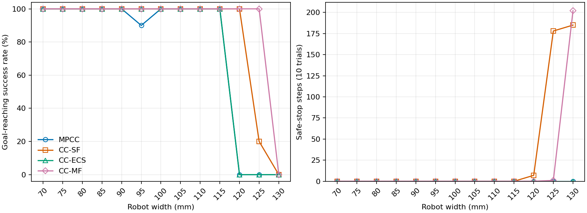

# Rectangle 너비별 주행 benchmark (0.005 m 간격)

실행일 2026-11-03 (KST). **520/520 trials 완료**.

maze / differential_drive (DD) / A*, rectangle 길이 0.150 m 고정. 너비 0.070–0.130 m, 간격 0.005 m의 13개 너비에서 MPCC·CC-SF·CC-MF·CC-ECS를 각 10회(seed 0–9) 같은 PC에서 순차 실행했다. Localization error는 끄고 animation은 생성하지 않았다.

설정은 `config/config_benchmark.yaml`의 현재 공통 조건을 사용했다. trial 제한 80 s, 이동 정체 창 10 s, 이동 임계값 0.03 m, 연속 실패 한도 20회다. 목표 위치 L1 오차 ≤0.02 m가 성공 판정이다. 접촉·겹침 자체는 별도 실패 조건이 아니다.

시작 자세에 x/y 표준편차 각각 0.02 m, heading 표준편차 0.05 rad, ±3σ의 Gaussian 교란을 적용했다. 모든 너비에서 초기 clearance ≥1 mm이며 같은 너비·seed의 네 방법은 시작 자세가 같다. 과거 보고서의 일부 너비(≥10 mm)와 초기 여유 조건이 다르다.

컨트롤러는 실행 시작 시점의 코드를 고정하고 기본 파라미터를 사용했다. 이전 실행과 파라미터도 다르므로 과거 결과와 직접적인 통제 비교는 할 수 없다.

| Controller | d_min (mm) | a_max (m/s²) | r_delta_omega | σf / σl / σψ (m / m / rad) |
|---|---:|---:|---:|---|
| MPCC | 0.1 | 0.3 | 0.1 | — |
| CC-SF | 0.1 | 0.3 | 0.1 | 0.0002 / 0.00025 / 0.00025 |
| CC-ECS | 0.1 | 0.3 | 0.1 | 0.0002 / 0.00025 / 0.00025 |
| CC-MF | 0.1 | 0.3 | 0.1 | 0.0002 / 0.00025 / 0.00025 |

## 지표 정의

- Clearance: 초기 및 매 적분 후 실제 rectangle과 장애물의 정확한 polygon 거리, 지도 경계 margin 중 최솟값. 접촉·겹침은 0, 지도 경계 침범은 음수다. 성공·실패 trial의 전체 표본을 합쳐 mean/P05를 계산한다.
- Computation time: local reference 생성부터 controller 전처리·파라미터 갱신·solver·복구·내부 로깅까지의 제어 사이클 wall-clock 시간(perf_counter + CUDA 동기화). 각 trial 첫 사이클은 제외하고 이후 실패·fallback도 포함한다. 경로 계획·plant 적분·결과 저장은 제외한다. 전체 유효 step을 합쳐 mean/P95를 계산한다.
- Traversal time: 성공 trial의 시뮬레이션 시간 평균. 성공 0건은 —다.
- Safe stop: zero-input fallback 제어 step 합계(연속 정지도 매 step 집계). MPCC는 해당 fallback이 없어 0이다. 계측 유실 시 확인 가능한 하한을 ≥로 표시한다.

## 성공률

| Width (m) | MPCC | CC-SF | CC-ECS | CC-MF |
|---:|---:|---:|---:|---:|
| 0.070 | 10/10 | 10/10 | 10/10 | 10/10 |
| 0.075 | 10/10 | 10/10 | 10/10 | 10/10 |
| 0.080 | 10/10 | 10/10 | 10/10 | 10/10 |
| 0.085 | 10/10 | 10/10 | 10/10 | 10/10 |
| 0.090 | 10/10 | 10/10 | 10/10 | 10/10 |
| 0.095 | 9/10 | 10/10 | 10/10 | 10/10 |
| 0.100 | 10/10 | 10/10 | 10/10 | 10/10 |
| 0.105 | 10/10 | 10/10 | 10/10 | 10/10 |
| 0.110 | 10/10 | 10/10 | 10/10 | 10/10 |
| 0.115 | 10/10 | 10/10 | 10/10 | 10/10 |
| 0.120 | 0/10 | 10/10 | 0/10 | 10/10 |
| 0.125 | 0/10 | 2/10 | 0/10 | 10/10 |
| 0.130 | 0/10 | 0/10 | 0/10 | 0/10 |

## 상세 결과

| Width (m) | Controller | 성공/완료 | Mean clearance (mm) | P05 clearance (mm) | Mean computation (ms/step) | P95 computation (ms/step) | Mean traversal (s) | Safe stop (step) |
|---:|---|---:|---:|---:|---:|---:|---:|---:|
| 0.070 | MPCC | 10/10 | 8.016 | 0.649 | 29.435 | 42.960 | 23.05 | 0 |
| 0.070 | CC-SF | 10/10 | 12.563 | 4.018 | 33.075 | 47.494 | 22.14 | 0 |
| 0.070 | CC-ECS | 10/10 | 8.936 | 1.440 | 33.185 | 43.613 | 25.03 | 0 |
| 0.070 | CC-MF | 10/10 | 12.252 | 4.075 | 34.939 | 48.289 | 24.87 | 0 |
| 0.075 | MPCC | 10/10 | 8.099 | 0.675 | 28.338 | 39.787 | 23.65 | 0 |
| 0.075 | CC-SF | 10/10 | 12.548 | 4.067 | 32.453 | 45.081 | 22.65 | 0 |
| 0.075 | CC-ECS | 10/10 | 9.108 | 1.487 | 32.592 | 42.261 | 25.38 | 0 |
| 0.075 | CC-MF | 10/10 | 12.059 | 3.860 | 34.359 | 44.885 | 25.65 | 0 |
| 0.080 | MPCC | 10/10 | 8.135 | 0.665 | 28.787 | 39.942 | 24.52 | 0 |
| 0.080 | CC-SF | 10/10 | 12.349 | 3.981 | 32.553 | 44.217 | 23.65 | 0 |
| 0.080 | CC-ECS | 10/10 | 8.984 | 1.450 | 32.956 | 42.689 | 26.27 | 0 |
| 0.080 | CC-MF | 10/10 | 11.746 | 3.611 | 35.452 | 50.618 | 26.94 | 0 |
| 0.085 | MPCC | 10/10 | 8.048 | 0.671 | 28.785 | 39.796 | 25.37 | 0 |
| 0.085 | CC-SF | 10/10 | 12.144 | 4.020 | 32.946 | 46.199 | 24.42 | 0 |
| 0.085 | CC-ECS | 10/10 | 8.746 | 1.397 | 33.318 | 44.435 | 27.27 | 0 |
| 0.085 | CC-MF | 10/10 | 11.523 | 3.640 | 35.195 | 47.324 | 27.76 | 0 |
| 0.090 | MPCC | 10/10 | 7.781 | 0.670 | 28.926 | 40.821 | 25.93 | 0 |
| 0.090 | CC-SF | 10/10 | 11.575 | 3.956 | 33.131 | 46.292 | 25.06 | 0 |
| 0.090 | CC-ECS | 10/10 | 8.506 | 1.401 | 33.164 | 42.527 | 27.92 | 0 |
| 0.090 | CC-MF | 10/10 | 10.895 | 3.501 | 35.694 | 48.927 | 29.43 | 0 |
| 0.095 | MPCC | 9/10 | 7.508 | 0.506 | 28.917 | 40.731 | 26.87 | 0 |
| 0.095 | CC-SF | 10/10 | 10.636 | 3.778 | 32.966 | 45.498 | 26.12 | 0 |
| 0.095 | CC-ECS | 10/10 | 8.127 | 1.362 | 33.429 | 44.377 | 29.08 | 0 |
| 0.095 | CC-MF | 10/10 | 9.899 | 3.444 | 35.188 | 46.203 | 32.53 | 0 |
| 0.100 | MPCC | 10/10 | 6.710 | 0.424 | 29.386 | 41.091 | 27.03 | 0 |
| 0.100 | CC-SF | 10/10 | 9.515 | 3.676 | 33.419 | 46.282 | 27.58 | 0 |
| 0.100 | CC-ECS | 10/10 | 7.409 | 1.202 | 33.475 | 43.738 | 30.51 | 0 |
| 0.100 | CC-MF | 10/10 | 8.923 | 3.471 | 35.388 | 46.370 | 35.97 | 0 |
| 0.105 | MPCC | 10/10 | 5.915 | 0.322 | 28.494 | 37.378 | 28.08 | 0 |
| 0.105 | CC-SF | 10/10 | 8.273 | 3.491 | 32.594 | 43.252 | 29.69 | 0 |
| 0.105 | CC-ECS | 10/10 | 6.253 | 1.264 | 33.965 | 46.298 | 32.72 | 0 |
| 0.105 | CC-MF | 10/10 | 7.517 | 2.822 | 35.774 | 47.850 | 40.37 | 0 |
| 0.110 | MPCC | 10/10 | 4.405 | 0.197 | 28.676 | 38.145 | 29.35 | 0 |
| 0.110 | CC-SF | 10/10 | 6.924 | 3.191 | 32.906 | 45.460 | 31.75 | 0 |
| 0.110 | CC-ECS | 10/10 | 4.536 | 1.095 | 33.809 | 45.140 | 38.12 | 0 |
| 0.110 | CC-MF | 10/10 | 7.067 | 2.759 | 36.214 | 48.662 | 46.07 | 0 |
| 0.115 | MPCC | 10/10 | 3.405 | 0.193 | 29.598 | 42.081 | 31.35 | 0 |
| 0.115 | CC-SF | 10/10 | 5.899 | 2.746 | 33.635 | 46.603 | 34.51 | 0 |
| 0.115 | CC-ECS | 10/10 | 3.708 | 1.025 | 33.704 | 42.968 | 44.80 | 0 |
| 0.115 | CC-MF | 10/10 | 6.331 | 1.758 | 35.522 | 46.154 | 47.71 | 0 |
| 0.120 | MPCC | 0/10 | 3.437 | 0.588 | 28.139 | 37.712 | — | 0 |
| 0.120 | CC-SF | 10/10 | 4.655 | 2.245 | 33.787 | 47.481 | 38.87 | 7 |
| 0.120 | CC-ECS | 0/10 | 2.718 | 1.058 | 32.687 | 44.027 | — | 0 |
| 0.120 | CC-MF | 10/10 | 5.328 | 0.870 | 36.031 | 47.973 | 48.54 | 0 |
| 0.125 | MPCC | 0/10 | 2.635 | 0.456 | 28.304 | 40.151 | — | 0 |
| 0.125 | CC-SF | 2/10 | 3.421 | 0.424 | 33.365 | 45.168 | 45.95 | 178 |
| 0.125 | CC-ECS | 0/10 | 2.061 | 0.848 | 32.796 | 44.618 | — | 0 |
| 0.125 | CC-MF | 10/10 | 3.863 | 0.639 | 35.911 | 48.480 | 49.61 | 1 |
| 0.130 | MPCC | 0/10 | 1.422 | 0.000 | 28.506 | 39.387 | — | 0 |
| 0.130 | CC-SF | 0/10 | 1.920 | 0.149 | 32.782 | 49.033 | — | 185 |
| 0.130 | CC-ECS | 0/10 | 1.812 | 0.958 | 32.331 | 44.608 | — | 0 |
| 0.130 | CC-MF | 0/10 | 2.202 | 0.000 | 36.420 | 52.283 | — | 202 |

## 실패 기록

목표 미도달 trial 89건. 성공률 분모에는 failure·timeout·error를 포함한다.

| Width (m) | Controller | Status | Failure reason | Count |
|---:|---|---|---|---:|
| 0.095 | MPCC | failure | consecutive_solver_failures(20): failure | 1 |
| 0.120 | CC-ECS | failure | stuck_for_10.00s_disp_0.0287m_le_0.0300m | 1 |
| 0.120 | CC-ECS | failure | stuck_for_10.00s_disp_0.0288m_le_0.0300m | 1 |
| 0.120 | CC-ECS | failure | stuck_for_10.00s_disp_0.0289m_le_0.0300m | 5 |
| 0.120 | CC-ECS | failure | stuck_for_10.00s_disp_0.0290m_le_0.0300m | 1 |
| 0.120 | CC-ECS | failure | stuck_for_10.00s_disp_0.0297m_le_0.0300m | 2 |
| 0.120 | MPCC | failure | stuck_for_10.00s_disp_0.0215m_le_0.0300m | 1 |
| 0.120 | MPCC | failure | stuck_for_10.00s_disp_0.0249m_le_0.0300m | 1 |
| 0.120 | MPCC | failure | stuck_for_10.00s_disp_0.0250m_le_0.0300m | 2 |
| 0.120 | MPCC | failure | stuck_for_10.00s_disp_0.0269m_le_0.0300m | 1 |
| 0.120 | MPCC | failure | stuck_for_10.00s_disp_0.0275m_le_0.0300m | 4 |
| 0.120 | MPCC | failure | stuck_for_10.00s_disp_0.0282m_le_0.0300m | 1 |
| 0.125 | CC-ECS | failure | stuck_for_10.00s_disp_0.0284m_le_0.0300m | 1 |
| 0.125 | CC-ECS | failure | stuck_for_10.00s_disp_0.0287m_le_0.0300m | 5 |
| 0.125 | CC-ECS | failure | stuck_for_10.00s_disp_0.0290m_le_0.0300m | 1 |
| 0.125 | CC-ECS | failure | stuck_for_10.00s_disp_0.0291m_le_0.0300m | 1 |
| 0.125 | CC-ECS | failure | stuck_for_10.00s_disp_0.0294m_le_0.0300m | 1 |
| 0.125 | CC-ECS | failure | stuck_for_10.00s_disp_0.0298m_le_0.0300m | 1 |
| 0.125 | CC-SF | failure | consecutive_solver_failures(20): failure | 8 |
| 0.125 | MPCC | failure | stuck_for_10.00s_disp_0.0215m_le_0.0300m | 2 |
| 0.125 | MPCC | failure | stuck_for_10.00s_disp_0.0216m_le_0.0300m | 5 |
| 0.125 | MPCC | failure | stuck_for_10.00s_disp_0.0218m_le_0.0300m | 1 |
| 0.125 | MPCC | failure | stuck_for_10.00s_disp_0.0225m_le_0.0300m | 1 |
| 0.125 | MPCC | failure | stuck_for_10.00s_disp_0.0228m_le_0.0300m | 1 |
| 0.130 | CC-ECS | failure | stuck_for_10.00s_disp_0.0277m_le_0.0300m | 1 |
| 0.130 | CC-ECS | failure | stuck_for_10.00s_disp_0.0282m_le_0.0300m | 1 |
| 0.130 | CC-ECS | failure | stuck_for_10.00s_disp_0.0284m_le_0.0300m | 1 |
| 0.130 | CC-ECS | failure | stuck_for_10.00s_disp_0.0286m_le_0.0300m | 2 |
| 0.130 | CC-ECS | failure | stuck_for_10.00s_disp_0.0288m_le_0.0300m | 3 |
| 0.130 | CC-ECS | failure | stuck_for_10.00s_disp_0.0291m_le_0.0300m | 2 |
| 0.130 | CC-MF | failure | consecutive_unsuccessful_control_steps(20): safe_stop_stage0 | 10 |
| 0.130 | CC-SF | failure | consecutive_solver_failures(20): failure | 9 |
| 0.130 | CC-SF | failure | stuck_for_10.00s_disp_0.0242m_le_0.0300m | 1 |
| 0.130 | MPCC | failure | consecutive_solver_failures(20): failure | 10 |

Trial별 실패 상세

| Width (m) | Controller | Seed | End time (s) | Failure reason |
|---:|---|---:|---:|---|
| 0.095 | MPCC | 8 | 12.6 | consecutive_solver_failures(20): failure |
| 0.120 | MPCC | 0 | 16.7 | stuck_for_10.00s_disp_0.0249m_le_0.0300m |
| 0.120 | CC-ECS | 0 | 17.5 | stuck_for_10.00s_disp_0.0289m_le_0.0300m |
| 0.120 | CC-ECS | 1 | 17.7 | stuck_for_10.00s_disp_0.0289m_le_0.0300m |
| 0.120 | MPCC | 1 | 16.7 | stuck_for_10.00s_disp_0.0275m_le_0.0300m |
| 0.120 | CC-ECS | 2 | 17.4 | stuck_for_10.00s_disp_0.0288m_le_0.0300m |
| 0.120 | MPCC | 2 | 16.6 | stuck_for_10.00s_disp_0.0250m_le_0.0300m |
| 0.120 | MPCC | 3 | 17.4 | stuck_for_10.00s_disp_0.0215m_le_0.0300m |
| 0.120 | CC-ECS | 3 | 26.6 | stuck_for_10.00s_disp_0.0297m_le_0.0300m |
| 0.120 | MPCC | 4 | 16.6 | stuck_for_10.00s_disp_0.0250m_le_0.0300m |
| 0.120 | CC-ECS | 4 | 17.7 | stuck_for_10.00s_disp_0.0287m_le_0.0300m |
| 0.120 | CC-ECS | 5 | 17.6 | stuck_for_10.00s_disp_0.0290m_le_0.0300m |
| 0.120 | MPCC | 5 | 16.7 | stuck_for_10.00s_disp_0.0275m_le_0.0300m |
| 0.120 | CC-ECS | 6 | 17.6 | stuck_for_10.00s_disp_0.0289m_le_0.0300m |
| 0.120 | MPCC | 6 | 16.7 | stuck_for_10.00s_disp_0.0269m_le_0.0300m |
| 0.120 | MPCC | 7 | 16.6 | stuck_for_10.00s_disp_0.0275m_le_0.0300m |
| 0.120 | CC-ECS | 7 | 17.5 | stuck_for_10.00s_disp_0.0289m_le_0.0300m |
| 0.120 | MPCC | 8 | 21.0 | stuck_for_10.00s_disp_0.0282m_le_0.0300m |
| 0.120 | CC-ECS | 8 | 26.0 | stuck_for_10.00s_disp_0.0297m_le_0.0300m |
| 0.120 | CC-ECS | 9 | 17.6 | stuck_for_10.00s_disp_0.0289m_le_0.0300m |
| 0.120 | MPCC | 9 | 16.6 | stuck_for_10.00s_disp_0.0275m_le_0.0300m |
| 0.125 | MPCC | 0 | 17.8 | stuck_for_10.00s_disp_0.0218m_le_0.0300m |
| 0.125 | CC-SF | 0 | 24.4 | consecutive_solver_failures(20): failure |
| 0.125 | CC-ECS | 0 | 17.7 | stuck_for_10.00s_disp_0.0294m_le_0.0300m |
| 0.125 | CC-SF | 1 | 10.3 | consecutive_solver_failures(20): failure |
| 0.125 | CC-ECS | 1 | 17.7 | stuck_for_10.00s_disp_0.0287m_le_0.0300m |
| 0.125 | MPCC | 1 | 18.0 | stuck_for_10.00s_disp_0.0216m_le_0.0300m |
| 0.125 | CC-ECS | 2 | 17.5 | stuck_for_10.00s_disp_0.0284m_le_0.0300m |
| 0.125 | MPCC | 2 | 17.8 | stuck_for_10.00s_disp_0.0215m_le_0.0300m |
| 0.125 | CC-SF | 2 | 24.8 | consecutive_solver_failures(20): failure |
| 0.125 | MPCC | 3 | 17.7 | stuck_for_10.00s_disp_0.0225m_le_0.0300m |
| 0.125 | CC-ECS | 3 | 20.2 | stuck_for_10.00s_disp_0.0298m_le_0.0300m |
| 0.125 | MPCC | 4 | 17.9 | stuck_for_10.00s_disp_0.0216m_le_0.0300m |
| 0.125 | CC-SF | 4 | 52.8 | consecutive_solver_failures(20): failure |
| 0.125 | CC-ECS | 4 | 17.6 | stuck_for_10.00s_disp_0.0287m_le_0.0300m |
| 0.125 | CC-SF | 5 | 10.2 | consecutive_solver_failures(20): failure |
| 0.125 | CC-ECS | 5 | 17.9 | stuck_for_10.00s_disp_0.0287m_le_0.0300m |
| 0.125 | MPCC | 5 | 18.0 | stuck_for_10.00s_disp_0.0216m_le_0.0300m |
| 0.125 | CC-ECS | 6 | 17.9 | stuck_for_10.00s_disp_0.0290m_le_0.0300m |
| 0.125 | MPCC | 6 | 17.9 | stuck_for_10.00s_disp_0.0216m_le_0.0300m |
| 0.125 | MPCC | 7 | 18.0 | stuck_for_10.00s_disp_0.0216m_le_0.0300m |
| 0.125 | CC-SF | 7 | 30.7 | consecutive_solver_failures(20): failure |
| 0.125 | CC-ECS | 7 | 17.6 | stuck_for_10.00s_disp_0.0287m_le_0.0300m |
| 0.125 | MPCC | 8 | 17.5 | stuck_for_10.00s_disp_0.0228m_le_0.0300m |
| 0.125 | CC-SF | 8 | 50.0 | consecutive_solver_failures(20): failure |
| 0.125 | CC-ECS | 8 | 20.2 | stuck_for_10.00s_disp_0.0291m_le_0.0300m |
| 0.125 | CC-SF | 9 | 50.3 | consecutive_solver_failures(20): failure |
| 0.125 | CC-ECS | 9 | 17.6 | stuck_for_10.00s_disp_0.0287m_le_0.0300m |
| 0.125 | MPCC | 9 | 18.0 | stuck_for_10.00s_disp_0.0215m_le_0.0300m |
| 0.130 | MPCC | 0 | 8.9 | consecutive_solver_failures(20): failure |
| 0.130 | CC-SF | 0 | 7.3 | consecutive_solver_failures(20): failure |
| 0.130 | CC-ECS | 0 | 22.0 | stuck_for_10.00s_disp_0.0288m_le_0.0300m |
| 0.130 | CC-MF | 0 | 6.1 | consecutive_unsuccessful_control_steps(20): safe_stop_stage0 |
| 0.130 | CC-SF | 1 | 12.4 | stuck_for_10.00s_disp_0.0242m_le_0.0300m |
| 0.130 | CC-ECS | 1 | 22.2 | stuck_for_10.00s_disp_0.0282m_le_0.0300m |
| 0.130 | CC-MF | 1 | 6.8 | consecutive_unsuccessful_control_steps(20): safe_stop_stage0 |
| 0.130 | MPCC | 1 | 10.8 | consecutive_solver_failures(20): failure |
| 0.130 | CC-ECS | 2 | 21.9 | stuck_for_10.00s_disp_0.0286m_le_0.0300m |
| 0.130 | CC-MF | 2 | 59.6 | consecutive_unsuccessful_control_steps(20): safe_stop_stage0 |
| 0.130 | MPCC | 2 | 8.9 | consecutive_solver_failures(20): failure |
| 0.130 | CC-SF | 2 | 7.1 | consecutive_solver_failures(20): failure |
| 0.130 | CC-MF | 3 | 7.8 | consecutive_unsuccessful_control_steps(20): safe_stop_stage0 |
| 0.130 | MPCC | 3 | 9.0 | consecutive_solver_failures(20): failure |
| 0.130 | CC-SF | 3 | 24.6 | consecutive_solver_failures(20): failure |
| 0.130 | CC-ECS | 3 | 13.4 | stuck_for_10.00s_disp_0.0286m_le_0.0300m |
| 0.130 | MPCC | 4 | 9.0 | consecutive_solver_failures(20): failure |
| 0.130 | CC-SF | 4 | 6.8 | consecutive_solver_failures(20): failure |
| 0.130 | CC-ECS | 4 | 22.2 | stuck_for_10.00s_disp_0.0291m_le_0.0300m |
| 0.130 | CC-MF | 4 | 38.2 | consecutive_unsuccessful_control_steps(20): safe_stop_stage0 |
| 0.130 | CC-SF | 5 | 14.5 | consecutive_solver_failures(20): failure |
| 0.130 | CC-ECS | 5 | 22.3 | stuck_for_10.00s_disp_0.0288m_le_0.0300m |
| 0.130 | CC-MF | 5 | 2.4 | consecutive_unsuccessful_control_steps(20): safe_stop_stage0 |
| 0.130 | MPCC | 5 | 9.3 | consecutive_solver_failures(20): failure |
| 0.130 | CC-ECS | 6 | 22.1 | stuck_for_10.00s_disp_0.0291m_le_0.0300m |
| 0.130 | CC-MF | 6 | 14.6 | consecutive_unsuccessful_control_steps(20): safe_stop_stage0 |
| 0.130 | MPCC | 6 | 9.5 | consecutive_solver_failures(20): failure |
| 0.130 | CC-SF | 6 | 6.5 | consecutive_solver_failures(20): failure |
| 0.130 | CC-MF | 7 | 7.8 | consecutive_unsuccessful_control_steps(20): safe_stop_stage0 |
| 0.130 | MPCC | 7 | 9.0 | consecutive_solver_failures(20): failure |
| 0.130 | CC-SF | 7 | 6.5 | consecutive_solver_failures(20): failure |
| 0.130 | CC-ECS | 7 | 22.0 | stuck_for_10.00s_disp_0.0288m_le_0.0300m |
| 0.130 | MPCC | 8 | 10.6 | consecutive_solver_failures(20): failure |
| 0.130 | CC-SF | 8 | 17.2 | consecutive_solver_failures(20): failure |
| 0.130 | CC-ECS | 8 | 13.0 | stuck_for_10.00s_disp_0.0277m_le_0.0300m |
| 0.130 | CC-MF | 8 | 32.3 | consecutive_unsuccessful_control_steps(20): safe_stop_stage0 |
| 0.130 | CC-SF | 9 | 6.8 | consecutive_solver_failures(20): failure |
| 0.130 | CC-ECS | 9 | 13.4 | stuck_for_10.00s_disp_0.0284m_le_0.0300m |
| 0.130 | CC-MF | 9 | 6.0 | consecutive_unsuccessful_control_steps(20): safe_stop_stage0 |
| 0.130 | MPCC | 9 | 4.3 | consecutive_solver_failures(20): failure |

## 실행 자료

Python 3.10.13, PyTorch 2.4.1, CasADi 3.7.0, NVIDIA GeForce RTX 3060, Torch CPU threads 6.

[실행 조건·전체 파라미터](experiment.json) · [Trial 결과](trial_results.csv) · [52개 조합 집계](benchmark_summary.csv) · [검증 기록](report_integrity.json)
