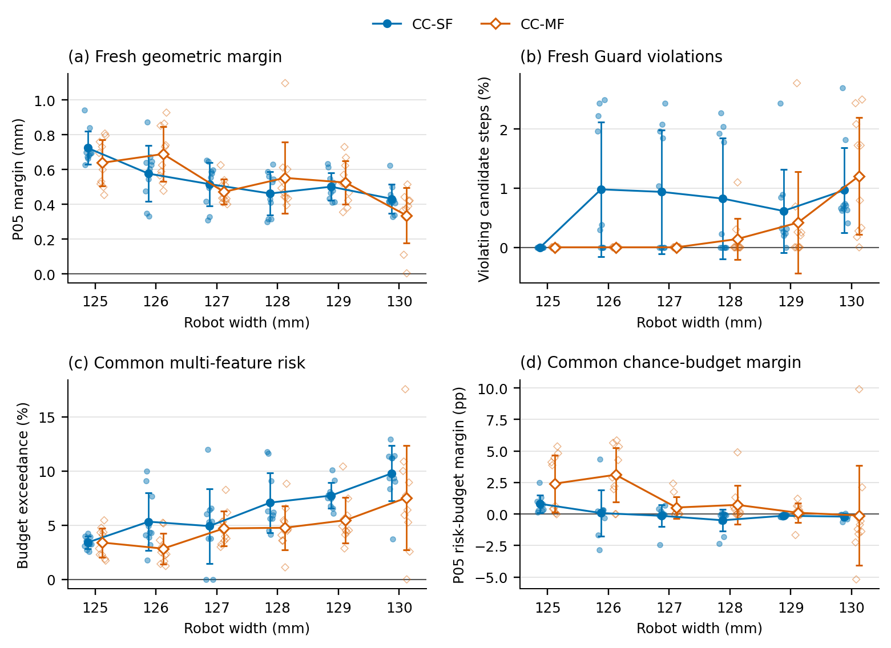
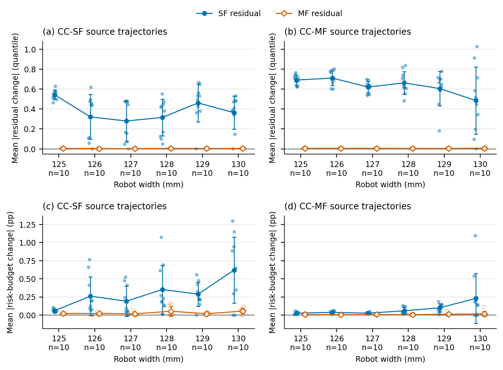
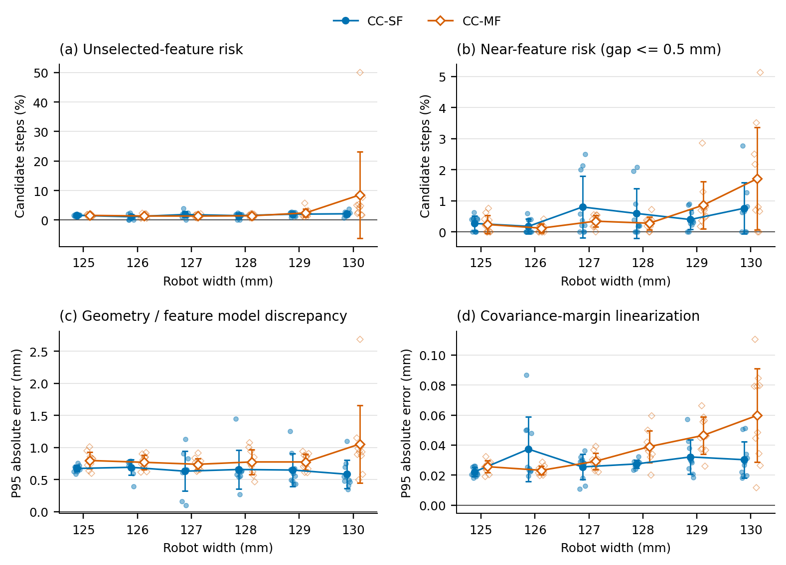
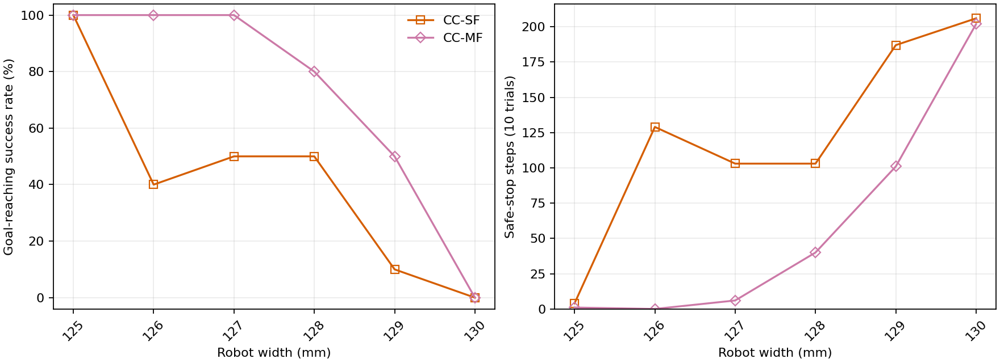
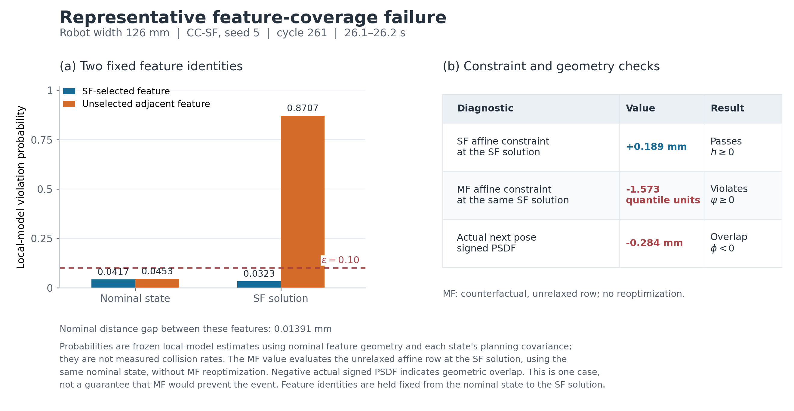

<!-- constraint-stability:120trials_20261105:start -->

# 120회 주행의 constraint margin·위험도·switching 통계

분석일 2026-11-05(KST). 2026-11-04의 기존 120개 trial을 재분석했으며 새 주행은 실행하지 않았다. 폭 125–130 mm, 두 방법, 각 seed 0–9를 모두 포함한다. Stage 1(0.1 s)을 주 분석, stage 10(1 s 예측)을 보조 분석으로 고정했다. 성공 trial이나 특정 주행 위치만 선택하지 않았다.

**핵심 결과:** 동일 상태·covariance의 switching-boundary 비교에서 trial 평균 quantile 변화가 MF 쪽이 작은 경우는 stage 1 **118/120**, stage 10 **119/119**였다. 확률예산 잔차 변화로 비교하면 각각 **116/120**, **119/119**다. 이 분모는 유효 경계가 있는 source trajectory trial 수이며, 경계를 독립 반복으로 센 수가 아니다. 실제 주행 경로의 공통 위험예산 초과율 평균이 MF에서 낮은 폭은 **125, 126, 127, 128, 129, 130 mm**였다. 경계 국소 민감도와 폐루프 주행의 margin·위험도는 구분해 해석한다.

## 분석 단위와 공통 기준

각 trial에서 평균·SD·P05·P95·위반 비율을 먼저 계산하고, 폭별 10개 trial 통계를 동일 가중으로 평균냈다. 그림의 작은 점은 trial 하나, 큰 점은 trial 통계의 평균, 오차막대는 **trial 간 sample SD(ddof=1)**다. 이는 standard error나 confidence interval이 아니다. 동일 seed를 폭별로 재사용했으므로 60개 또는 120개를 독립 반복으로 가정한 검정은 하지 않았다. 유효 표본이 없는 trial 통계는 NaN이며 0으로 대체하지 않는다.

- **공통 geometric margin:** h_G = φ−d_col [mm], d_col=0.05 mm. 해에서 geometry를 새로 평가한 값이다. h_G<−1 µm를 유의미한 음수 진단 기준으로 쓴다.
- **공통 chance-budget margin:** b=ε−R, R=Σ_i p_i, p_i=Φ((d_min−d_i)/σ_i), ε=0.1, d_min=0.1 mm. 두 방법의 궤적에 같은 multi-feature 평가를 적용한다. R은 구현의 Gaussian/Boole surrogate sum으로 중복 feature가 포함되고 1을 넘을 수 있다. 관측 충돌 확률이나 정확한 union probability가 아니다.
- **위험도 domain:** fresh φ>d_min인 separated geometry에서만 p_i와 R 통계를 사용한다. Domain 밖을 위험도 0으로 넣지 않고, domain 이탈 비율 및 `domain 이탈 OR R>ε` 비율을 별도 보고한다.
- **최적화 해의 분모:** 성공한 normal solve의 후보 상태를 사용한다. 실패한 solver iterate는 저장되지 않아 복원하지 않는다. 실패 trial도 종료 전의 유효 후보는 포함한다. 반복된 20-step terminal Guard stop은 위험도 평균에 반복 삽입하지 않고 실제 geometry/실패 통계로 분리한다.
- **계획 covariance:** 각 후보해에 저장된 body-local planning covariance로 모델 위험도를 계산한다. 실제 측정 covariance나 Monte Carlo 충돌 확률이 아니다. Stage 10은 실행된 다음 pose가 아닌 horizon 예측이다.
- **단위와 cap:** native SF 거리 잔차와 MF quantile 잔차의 크기·SD를 직접 비교하지 않는다. 공통 SF 거리 진단은 두 궤적 모두 archived SF의 floor/cap/gamma를 사용한다. Unclipped SF quantile은 cap이 활성인 native SF row와 동치가 아니다.

## 주행 궤적에서의 공통 margin·위험도

각 항목은 **trial별 통계의 mean ± SD**다. Chance-budget margin은 percentage points(pp)로 표시한다. R 초과율은 valid separated 후보에 대한 조건부 비율이다.

| 폭(mm) | SF P05 h_G(mm) | MF P05 h_G(mm) | SF R 초과율(%) | MF R 초과율(%) | SF P05 b(pp) | MF P05 b(pp) |
|---:|---:|---:|---:|---:|---:|---:|
| 125 | 0.725 ± 0.095 | 0.640 ± 0.134 | 3.410 ± 0.559 | 3.399 ± 1.341 | 0.811 ± 0.697 | 2.415 ± 2.264 |
| 126 | 0.577 ± 0.161 | 0.690 ± 0.156 | 5.326 ± 2.680 | 2.839 ± 1.429 | 0.079 ± 1.835 | 3.118 ± 2.156 |
| 127 | 0.517 ± 0.125 | 0.472 ± 0.072 | 4.918 ± 3.458 | 4.707 ± 1.612 | -0.142 ± 0.853 | 0.518 ± 0.867 |
| 128 | 0.463 ± 0.124 | 0.553 ± 0.204 | 7.084 ± 2.762 | 4.763 ± 2.034 | -0.493 ± 0.868 | 0.728 ± 1.525 |
| 129 | 0.502 ± 0.078 | 0.526 ± 0.124 | 7.730 ± 1.182 | 5.460 ± 2.124 | -0.135 ± 0.079 | 0.103 ± 0.753 |
| 130 | 0.433 ± 0.083 | 0.338 ± 0.158 | 9.783 ± 2.560 | 7.527 ± 4.829 | -0.204 ± 0.199 | -0.114 ± 3.962 |

126·128·129 mm에서는 공통 R 초과율 평균이 MF에서 낮았지만, 125 mm의 차이는 매우 작고 공통 시간 비교에서 부호가 바뀐다. P05 geometric margin은 125·127·130 mm에서 오히려 SF가 크다. 130 mm에서는 두 방법 모두 실패했고 MF의 probability-domain 이탈 비율도 커서, 조건부 R 초과율 하나로 안전성 우위를 주장하지 않는다.

P05 budget margin과 P95 R은 b_P05=ε−R_P95 관계다. 평균 R 및 trial 내 SD도 버리지 않고 [risk moment 그림](figures/figS06_risk_mean_and_dispersion.pdf)에 표시했다. 드문 큰 covariance 상태는 평균·SD를 크게 바꿀 수 있으므로 P05/P95와 함께 해석한다.

[Domain·실제 geometry·QP fallback](figures/figS02_domain_and_execution.pdf)에서는 위험도 domain 밖 후보를 별도로 집계하고 실제 최소 signed PSDF를 보존한다. [동일 seed 공통 시간 비교](figures/figS04_paired_exposure_sensitivity.pdf)는 두 trial의 마지막 normal solve 중 더 이른 시각까지 양쪽을 잘라 결과를 비교한다. 이는 관측 길이의 민감도 분석이며 같은 pose·covariance로 매칭한 인과 실험은 아니다. 모든 scope의 평균·SD와 paired 차이를 CSV에 저장했다.

## Feature switching 전후 잔차 변화

각 궤적의 인접한 유효 nominal state에서 canonical selected feature가 바뀐 구간을 찾았다. 특정 progress 범위나 성공 여부로 고르지 않았다. 양끝 selector가 같고 중간에서 왕복 전환하는 구간은 탐지 대상이 아니므로 모든 기하학적 경계의 전수조사라고 부르지 않는다.

탐지된 경계 양쪽에 각각 10 µm의 유한 offset을 두고, **같은 두 상태와 고정된 왼쪽 body-frame covariance**에 SF와 MF를 함께 평가했다. 이동 크기는 ||Δxy||+r|Δθ|로 정의했다. 관측 구간 밖으로 외삽하지 않았고, 양끝 feature가 다르며 MF active/valid인 separated domain만 썼다. 주 그림은 양끝 모두 ordinary inverse-CDF branch인 동일 사건 집합을 사용하므로 clipping/linear extension의 영향을 제외한다.

상단은 SF standardized quantile과 MF quantile의 절대 변화, 하단은 ε−p_selected와 ε−R의 절대 변화다. 둘 다 trial 내 사건들의 평균을 먼저 계산했다. 그림 아래 n은 사건 수가 아닌 유효 trial 수다. 5/50 µm offset, all-active branch, initial-grid-bracket 내부 subset, P95/RMS 결과도 모두 보존했다. 수학적인 jump limit나 전체 함수의 연속성 증명으로 해석하지 않는다. 50 µm offset의 125 mm SF-source 확률 단위 비교에서는 MF 변화가 약 7.1% 더 큰 반례도 있어, 지정된 offset 조건을 명시해야 한다.

| 폭(mm) | Source path | 유효 trial | SF 평균 | MF 평균 | SF 확률예산 변화(pp) | MF 확률예산 변화(pp) |
|---:|---|---:|---:|---:|---:|---:|
| 125 | CC-SF | 10 | 0.5429 ± 0.0476 | 0.0048 ± 0.0007 | 0.0603 ± 0.0214 | 0.0193 ± 0.0135 |
| 125 | CC-MF | 10 | 0.6904 ± 0.0503 | 0.0054 ± 0.0005 | 0.0264 ± 0.0170 | 0.0062 ± 0.0085 |
| 126 | CC-SF | 10 | 0.3208 ± 0.2245 | 0.0034 ± 0.0016 | 0.2607 ± 0.2659 | 0.0236 ± 0.0154 |
| 126 | CC-MF | 10 | 0.7103 ± 0.0740 | 0.0053 ± 0.0007 | 0.0362 ± 0.0198 | 0.0044 ± 0.0032 |
| 127 | CC-SF | 10 | 0.2798 ± 0.2070 | 0.0025 ± 0.0014 | 0.1909 ± 0.2074 | 0.0165 ± 0.0225 |
| 127 | CC-MF | 10 | 0.6198 ± 0.0577 | 0.0050 ± 0.0006 | 0.0261 ± 0.0111 | 0.0063 ± 0.0054 |
| 128 | CC-SF | 10 | 0.3156 ± 0.1830 | 0.0048 ± 0.0013 | 0.3523 ± 0.3334 | 0.0529 ± 0.0653 |
| 128 | CC-MF | 10 | 0.6621 ± 0.1128 | 0.0043 ± 0.0011 | 0.0581 ± 0.0462 | 0.0044 ± 0.0033 |
| 129 | CC-SF | 10 | 0.4606 ± 0.1910 | 0.0038 ± 0.0015 | 0.2886 ± 0.1656 | 0.0182 ± 0.0137 |
| 129 | CC-MF | 10 | 0.6048 ± 0.1732 | 0.0045 ± 0.0012 | 0.1002 ± 0.0572 | 0.0115 ± 0.0172 |
| 130 | CC-SF | 10 | 0.3635 ± 0.1667 | 0.0039 ± 0.0020 | 0.6203 ± 0.4560 | 0.0547 ± 0.0353 |
| 130 | CC-MF | 10 | 0.4849 ± 0.3379 | 0.0060 ± 0.0069 | 0.2304 ± 0.3456 | 0.0167 ± 0.0335 |

[일반 주행의 temporal switching 변화](figures/figS03_temporal_switch_changes.pdf)도 따로 계산했다. 이는 실제 연속 cycle 사이의 pose와 covariance 변화가 함께 들어가므로 boundary의 국소 민감도와 다른 지표다. Switch/non-switch/all-adjacent 분모와 변화량을 모두 CSV에 남겼으며 결측·fallback을 건너뛰어 연결하지 않았다.

## 비선택 feature 위험과 모델 오차

앞선 사건별 35개 분석을 전체 유효 normal solve로 확대했다. Nominal feature를 고정한 채 후보해에서 `p_selected≤ε−1e−6`이고 `max p_other>ε+1e−6`인 비율을 trial별로 계산했다. 선택 feature와 같은 거리·전체 gradient를 가진 중복 slot은 대안에서 제외했다. 위험해진 대안의 nominal 거리차가 0.5 mm 이하인 비율도 따로 보고한다.

동일 SF 진단 row에 대해 `h_fresh−h_frozen`과 `h_frozen−h_affine`을 분리했다. 앞의 차이는 geometry 재평가 및 gradient/orientation 변화, 뒤의 차이는 covariance-state에 대한 risk-margin 선형화 오차다. 뒤의 값을 covariance dynamics defect라고 부르지 않는다. MF 궤적에서도 같은 SF row로 평가한 counterfactual 진단이며 native MF residual이 아니다.

비선택 feature 위험 빈도는 전체 주행 평균에서 MF가 일관되게 낮지 않았다. 특히 126·129·130 mm에서는 그 반대 방향도 관찰된다. 따라서 대표 충돌 사례에서 확인한 omission 메커니즘을 모든 주행의 주원인이나 일관된 감소율로 확대하지 않는다. 130 mm MF seed 5는 normal solve 4개, common risk-domain 후보 2개뿐이므로 trial 평균율의 높은 값과 큰 SD는 짧은 관측 구간과 함께 읽어야 한다.

## Covariance 일관성에 대한 보조 검산

[같은 후보 pose의 covariance 감도 그림](figures/figS07_covariance_consistency.pdf)은 저장된 최적화 covariance와, reset 초기 covariance에서 실제 적용 입력으로 한 step 전파한 covariance를 비교한다. 두 값 모두 모델 기반 planning covariance이며 실제 측정 불확실성이 아니다. 원래 데이터나 결과를 교체하지 않았다.

129 mm MF seed 1, cycle 120의 저장된 heading Log-Cholesky 상태가 +9.6245인 반면 같은 입력의 동역학 전파는 −4.6342였다. 원본 checkpoint와 cache가 일치하여 오프라인 복원 오류가 아니다. 같은 후보 pose의 R은 저장 covariance에서 **67.94494**, 동역학 전파 covariance에서 **0.00040533**이었다. 이 값은 solver success 여부와 별개인 비선형 covariance dynamics 일관성 문제를 보여주며 실제 충돌 확률로 해석할 수 없다.

129 mm MF의 trial별 평균 R의 mean±SD는 저장 covariance에서 **0.06817±0.15094**, 전파 covariance에서 **0.02102±0.00473**이었다. 반면 R 초과율은 **5.460±2.124% → 5.308±2.218%**로 방향이 유지됐다. 따라서 큰 covariance 이상값은 mean/SD를 크게 바꾸지만, 이 폭에서 관측된 위험예산 초과율 감소를 만들어낸 원인은 아니다. [전체 120-trial 보조 통계](raw_data/constraint_stability_20261105/rollout_covariance/mean_sd.csv)와 [원본 이상값 검증](raw_data/constraint_stability_20261105/covariance_outlier_audit.json)을 함께 보존했다.

## 논문에서의 해석 범위

- 같은 상태·covariance의 switching-boundary 결과는 **국소 constraint 민감도 차이**를 보여준다. 다른 궤적의 raw margin SD보다 방법의 수학적 구조와 직접 연결된다.
- 실제 궤적의 공통 margin·risk 초과율과 비선택 feature 위험 빈도는 **폐루프에서 관측된 조건부 차이**다. SF hard/ungated와 MF soft/gated 정책, 경로와 관측 길이의 차이가 함께 포함된다.
- 모든 지표가 MF에 유리하다고 가정하지 않는다. 폭별 반대 방향 결과, 극단값, domain 이탈, 없는 trial 통계도 보존했다. Source trajectory와 evaluator를 구분하고, 모델 위험도를 실제 충돌 확률로 부르지 않는다.
- 현재 실험은 localization error를 끈 설정이다. 실제 확률적 충돌 보장의 검증에는 별도의 오차 샘플링 실험이 필요하다.

## 파일과 재현

주 그림: [공통 margin·risk PDF](figures/fig01_common_margin_risk.pdf) · [Boundary PDF](figures/fig02_switch_boundary.pdf) · [Feature coverage PDF](figures/fig03_feature_coverage.pdf).

보조 그림: [Stage 10 margin·risk](figures/figS01_stage10_margin_risk.pdf) · [Domain·실제 주행](figures/figS02_domain_and_execution.pdf) · [Temporal 변화](figures/figS03_temporal_switch_changes.pdf) · [공통 시간](figures/figS04_paired_exposure_sensitivity.pdf) · [Stage 10 boundary](figures/figS05_stage10_switch_boundary.pdf) · [Risk mean·SD](figures/figS06_risk_mean_and_dispersion.pdf).

숫자: [Trial별 지표](raw_data/constraint_stability_20261105/trial_metrics.csv) · [폭별 mean·SD](raw_data/constraint_stability_20261105/width_mean_sd.csv) · [Paired 차이](raw_data/constraint_stability_20261105/paired_trial_differences.csv) · [Boundary trial 통계](raw_data/constraint_stability_20261105/boundaries/per_trial_metrics.csv) · [Boundary 전체 사건](raw_data/constraint_stability_20261105/boundaries/all_events.csv) · [분모/coverage](raw_data/constraint_stability_20261105/coverage.csv).

재현 순서: `extract_constraint_stability.py` → `analyze_constraint_switch_boundaries.py` → `aggregate_constraint_stability.py` → `analyze_rollout_covariance_risk.py` → `plot_constraint_stability_paper.py` → `write_constraint_stability_report.py`. Python은 기존 `pp` 환경을 사용한다. 원본 120회 로그와 source snapshot은 수정하지 않는다. Figure caption에는 각 그림의 분모·단위·오차막대 정의를 기록했다.

<!-- constraint-stability:120trials_20261105:end -->

---

<!-- width-sweep:sf_mf_width125_130mm_step001_10trials_20261104:start -->

# Rectangle 너비별 주행 benchmark — CC-SF·CC-MF

실행일 2026-11-04 (KST). **120/120 trials 완료**.

maze / differential_drive (DD) / A*, rectangle 길이 0.150 m 고정. 너비 0.125, 0.126, 0.127, 0.128, 0.129, 0.130 m의 6개 너비에서 CC-SF·CC-MF를 각 10회(seed 0–9) 같은 PC에서 순차 실행했다. Localization error는 끄고 animation은 생성하지 않았다.

설정은 `config/config_benchmark.yaml`의 현재 공통 조건을 사용했다. trial 제한 80 s, 이동 정체 창 10 s, 이동 임계값 0.03 m, 연속 실패 한도 20회다. 목표 위치 L1 오차 ≤0.02 m가 성공 판정이다. 접촉·겹침 자체는 별도 실패 조건이 아니다.

시작 자세에 x/y 표준편차 각각 0.02 m, heading 표준편차 0.05 rad, ±3σ의 Gaussian 교란을 적용했다. 모든 너비에서 초기 clearance ≥1 mm이며 같은 너비·seed의 방법들은 시작 자세가 같다. 과거 보고서의 일부 너비(≥10 mm)와 초기 여유 조건이 다르다.

컨트롤러는 실행 시작 시점의 코드를 고정하고 기본 파라미터를 사용했다. 이번 CC-SF는 2026-11-04 수정 버전으로, 미래 stages 1–20(terminal 포함)에 hard PSDF Guard와 hard SF row를 적용하고 stage 0에는 exact PSDF precheck만 사용한다. Guard 기준은 두 방법 모두 `d_col=0.05 mm`다. SF는 hard·ungated, MF는 soft·domain-gated chance row이므로 이 비교가 feature aggregation만을 분리하지는 않는다.

SF 파라미터·소스는 직전 125 mm Guard ablation과 같고 MF 파라미터·소스는 2026-11-03 baseline과 같다. 새 125 mm MF 10개 trial은 이전 baseline의 상태·종료시간·정지횟수뿐 아니라 clearance 및 checkpoint 파일도 일치했다. 전체 60개 폭·seed 쌍의 시작 pose가 정확히 일치하고, 120개 trial 모두 로그 유실 없이 완료됐다.

| Controller | d_min (mm) | a_max (m/s²) | r_delta_omega | σf / σl / σψ (m / m / rad) |
|---|---:|---:|---:|---|
| CC-SF | 0.1 | 0.3 | 0.1 | 0.0002 / 0.00025 / 0.00025 |
| CC-MF | 0.1 | 0.3 | 0.1 | 0.0002 / 0.00025 / 0.00025 |

## 지표 정의

- Clearance: 초기 및 매 적분 후 실제 rectangle과 장애물의 정확한 polygon 거리, 지도 경계 margin 중 최솟값. 접촉·겹침은 0, 지도 경계 침범은 음수다. 성공·실패 trial의 전체 표본을 합쳐 mean/P05를 계산한다.
- Computation time: local reference 생성부터 controller 전처리·파라미터 갱신·solver·복구·내부 로깅까지의 제어 사이클 wall-clock 시간(perf_counter + CUDA 동기화). 각 trial 첫 사이클은 제외하고 이후 실패·fallback도 포함한다. 경로 계획·plant 적분·결과 저장은 제외한다. 전체 유효 step을 합쳐 mean/P95를 계산한다.
- Traversal time: 성공 trial의 시뮬레이션 시간 평균. 성공 0건은 —다.
- Safe stop: zero-input fallback 제어 step 합계(연속 정지도 매 step 집계). MPCC는 해당 fallback이 없어 0이다. 계측 유실 시 확인 가능한 하한을 ≥로 표시한다.

## 성공률

| Width (m) | CC-SF | CC-MF |
|---:|---:|---:|
| 0.125 | 10/10 | 10/10 |
| 0.126 | 4/10 | 10/10 |
| 0.127 | 5/10 | 10/10 |
| 0.128 | 5/10 | 8/10 |
| 0.129 | 1/10 | 5/10 |
| 0.130 | 0/10 | 0/10 |

## 상세 결과

| Width (m) | Controller | 성공/완료 | Mean clearance (mm) | P05 clearance (mm) | Mean computation (ms/step) | P95 computation (ms/step) | Mean traversal (s) | Safe stop (step) |
|---:|---|---:|---:|---:|---:|---:|---:|---:|
| 0.125 | CC-SF | 10/10 | 3.565 | 0.754 | 31.966 | 42.829 | 47.86 | 4 |
| 0.125 | CC-MF | 10/10 | 3.863 | 0.639 | 34.043 | 45.494 | 49.61 | 1 |
| 0.126 | CC-SF | 4/10 | 3.027 | 0.402 | 31.064 | 41.954 | 50.85 | 129 |
| 0.126 | CC-MF | 10/10 | 3.692 | 0.718 | 34.007 | 46.319 | 50.53 | 0 |
| 0.127 | CC-SF | 5/10 | 2.896 | 0.476 | 31.066 | 41.498 | 50.20 | 103 |
| 0.127 | CC-MF | 10/10 | 3.263 | 0.488 | 33.747 | 44.298 | 55.56 | 6 |
| 0.128 | CC-SF | 5/10 | 2.784 | 0.489 | 31.488 | 42.135 | 53.12 | 103 |
| 0.128 | CC-MF | 8/10 | 3.038 | 0.488 | 33.706 | 44.100 | 56.20 | 40 |
| 0.129 | CC-SF | 1/10 | 2.367 | 0.000 | 31.019 | 41.059 | 55.70 | 187 |
| 0.129 | CC-MF | 5/10 | 2.733 | 0.441 | 33.310 | 43.485 | 57.34 | 101 |
| 0.130 | CC-SF | 0/10 | 1.948 | 0.000 | 29.973 | 39.820 | — | 206 |
| 0.130 | CC-MF | 0/10 | 2.202 | 0.000 | 33.274 | 45.406 | — | 202 |

## 실패 기록

목표 미도달 trial 52건. 성공률 분모에는 failure·timeout·error를 포함한다.

| Width (m) | Controller | Status | Failure reason | Count |
|---:|---|---|---|---:|
| 0.126 | CC-SF | failure | consecutive_unsuccessful_control_steps(20): safe_stop_stage0 | 6 |
| 0.127 | CC-SF | failure | consecutive_unsuccessful_control_steps(20): safe_stop_stage0 | 5 |
| 0.128 | CC-MF | failure | consecutive_unsuccessful_control_steps(20): safe_stop_stage0 | 2 |
| 0.128 | CC-SF | failure | consecutive_unsuccessful_control_steps(20): safe_stop_stage0 | 5 |
| 0.129 | CC-MF | failure | consecutive_unsuccessful_control_steps(20): safe_stop_stage0 | 5 |
| 0.129 | CC-SF | failure | consecutive_unsuccessful_control_steps(20): safe_stop_stage0 | 9 |
| 0.130 | CC-MF | failure | consecutive_unsuccessful_control_steps(20): safe_stop_stage0 | 10 |
| 0.130 | CC-SF | failure | consecutive_unsuccessful_control_steps(20): safe_stop_stage0 | 10 |

Trial별 실패 상세

| Width (m) | Controller | Seed | End time (s) | Failure reason |
|---:|---|---:|---:|---|
| 0.126 | CC-SF | 0 | 7.1 | consecutive_unsuccessful_control_steps(20): safe_stop_stage0 |
| 0.126 | CC-SF | 1 | 6.5 | consecutive_unsuccessful_control_steps(20): safe_stop_stage0 |
| 0.126 | CC-SF | 2 | 6.1 | consecutive_unsuccessful_control_steps(20): safe_stop_stage0 |
| 0.126 | CC-SF | 3 | 35.9 | consecutive_unsuccessful_control_steps(20): safe_stop_stage0 |
| 0.126 | CC-SF | 5 | 28.2 | consecutive_unsuccessful_control_steps(20): safe_stop_stage0 |
| 0.126 | CC-SF | 9 | 6.0 | consecutive_unsuccessful_control_steps(20): safe_stop_stage0 |
| 0.127 | CC-SF | 0 | 11.7 | consecutive_unsuccessful_control_steps(20): safe_stop_stage0 |
| 0.127 | CC-SF | 2 | 7.1 | consecutive_unsuccessful_control_steps(20): safe_stop_stage0 |
| 0.127 | CC-SF | 5 | 6.8 | consecutive_unsuccessful_control_steps(20): safe_stop_stage0 |
| 0.127 | CC-SF | 6 | 7.4 | consecutive_unsuccessful_control_steps(20): safe_stop_stage0 |
| 0.127 | CC-SF | 9 | 6.1 | consecutive_unsuccessful_control_steps(20): safe_stop_stage0 |
| 0.128 | CC-SF | 0 | 7.2 | consecutive_unsuccessful_control_steps(20): safe_stop_stage0 |
| 0.128 | CC-SF | 2 | 6.4 | consecutive_unsuccessful_control_steps(20): safe_stop_stage0 |
| 0.128 | CC-MF | 3 | 35.1 | consecutive_unsuccessful_control_steps(20): safe_stop_stage0 |
| 0.128 | CC-SF | 3 | 46.2 | consecutive_unsuccessful_control_steps(20): safe_stop_stage0 |
| 0.128 | CC-MF | 5 | 11.1 | consecutive_unsuccessful_control_steps(20): safe_stop_stage0 |
| 0.128 | CC-SF | 5 | 6.9 | consecutive_unsuccessful_control_steps(20): safe_stop_stage0 |
| 0.128 | CC-SF | 6 | 7.6 | consecutive_unsuccessful_control_steps(20): safe_stop_stage0 |
| 0.129 | CC-SF | 0 | 6.1 | consecutive_unsuccessful_control_steps(20): safe_stop_stage0 |
| 0.129 | CC-MF | 1 | 16.5 | consecutive_unsuccessful_control_steps(20): safe_stop_stage0 |
| 0.129 | CC-SF | 1 | 13.8 | consecutive_unsuccessful_control_steps(20): safe_stop_stage0 |
| 0.129 | CC-SF | 2 | 32.8 | consecutive_unsuccessful_control_steps(20): safe_stop_stage0 |
| 0.129 | CC-MF | 3 | 5.6 | consecutive_unsuccessful_control_steps(20): safe_stop_stage0 |
| 0.129 | CC-SF | 3 | 13.2 | consecutive_unsuccessful_control_steps(20): safe_stop_stage0 |
| 0.129 | CC-SF | 4 | 39.1 | consecutive_unsuccessful_control_steps(20): safe_stop_stage0 |
| 0.129 | CC-MF | 4 | 40.9 | consecutive_unsuccessful_control_steps(20): safe_stop_stage0 |
| 0.129 | CC-SF | 5 | 51.7 | consecutive_unsuccessful_control_steps(20): safe_stop_stage0 |
| 0.129 | CC-SF | 6 | 18.1 | consecutive_unsuccessful_control_steps(20): safe_stop_stage0 |
| 0.129 | CC-SF | 7 | 45.0 | consecutive_unsuccessful_control_steps(20): safe_stop_stage0 |
| 0.129 | CC-MF | 8 | 51.7 | consecutive_unsuccessful_control_steps(20): safe_stop_stage0 |
| 0.129 | CC-MF | 9 | 42.0 | consecutive_unsuccessful_control_steps(20): safe_stop_stage0 |
| 0.129 | CC-SF | 9 | 34.0 | consecutive_unsuccessful_control_steps(20): safe_stop_stage0 |
| 0.130 | CC-SF | 0 | 17.2 | consecutive_unsuccessful_control_steps(20): safe_stop_stage0 |
| 0.130 | CC-MF | 0 | 6.1 | consecutive_unsuccessful_control_steps(20): safe_stop_stage0 |
| 0.130 | CC-MF | 1 | 6.8 | consecutive_unsuccessful_control_steps(20): safe_stop_stage0 |
| 0.130 | CC-SF | 1 | 18.2 | consecutive_unsuccessful_control_steps(20): safe_stop_stage0 |
| 0.130 | CC-SF | 2 | 5.7 | consecutive_unsuccessful_control_steps(20): safe_stop_stage0 |
| 0.130 | CC-MF | 2 | 59.6 | consecutive_unsuccessful_control_steps(20): safe_stop_stage0 |
| 0.130 | CC-MF | 3 | 7.8 | consecutive_unsuccessful_control_steps(20): safe_stop_stage0 |
| 0.130 | CC-SF | 3 | 16.0 | consecutive_unsuccessful_control_steps(20): safe_stop_stage0 |
| 0.130 | CC-SF | 4 | 17.5 | consecutive_unsuccessful_control_steps(20): safe_stop_stage0 |
| 0.130 | CC-MF | 4 | 38.2 | consecutive_unsuccessful_control_steps(20): safe_stop_stage0 |
| 0.130 | CC-MF | 5 | 2.4 | consecutive_unsuccessful_control_steps(20): safe_stop_stage0 |
| 0.130 | CC-SF | 5 | 15.5 | consecutive_unsuccessful_control_steps(20): safe_stop_stage0 |
| 0.130 | CC-SF | 6 | 7.5 | consecutive_unsuccessful_control_steps(20): safe_stop_stage0 |
| 0.130 | CC-MF | 6 | 14.6 | consecutive_unsuccessful_control_steps(20): safe_stop_stage0 |
| 0.130 | CC-MF | 7 | 7.8 | consecutive_unsuccessful_control_steps(20): safe_stop_stage0 |
| 0.130 | CC-SF | 7 | 16.1 | consecutive_unsuccessful_control_steps(20): safe_stop_stage0 |
| 0.130 | CC-SF | 8 | 18.0 | consecutive_unsuccessful_control_steps(20): safe_stop_stage0 |
| 0.130 | CC-MF | 8 | 32.3 | consecutive_unsuccessful_control_steps(20): safe_stop_stage0 |
| 0.130 | CC-MF | 9 | 6.0 | consecutive_unsuccessful_control_steps(20): safe_stop_stage0 |
| 0.130 | CC-SF | 9 | 26.6 | consecutive_unsuccessful_control_steps(20): safe_stop_stage0 |

## 실행 자료

Python 3.10.13, PyTorch 2.4.1, CasADi 3.7.0, NVIDIA GeForce RTX 3060, Torch CPU threads 6.

[실행 조건·전체 파라미터](raw_data/experiment.json) · [Trial 결과](raw_data/trial_results.csv) · [12개 조합 집계](raw_data/benchmark_summary.csv) · [검증 기록](raw_data/report_integrity.json)

## Safe stop과 실제 기하학적 진입의 분리

두 방법 모두 미래 stages 1–20에 Guard를 적용하고 stage 0의 chance row를 제외한 조건에서도, 126–129 mm에서 MF의 완료율이 높았다. 전체 완료는 SF **25/60 (41.7%)**, MF **43/60 (71.7%)**다. 같은 폭·seed에서 MF만 성공한 쌍은 19개, SF만 성공한 쌍은 1개(129 mm, seed 8)였다. 125 mm에서는 모두 성공했고 130 mm에서는 모두 실패했다. 같은 10개 seed를 여러 폭에서 재사용한 탐색적 비교이므로 60개 결과를 독립 반복으로 간주하지 않는다.

| Width (mm) | Safe-stop steps SF / MF | 연속 stop episodes SF / MF | 실제 signed PSDF < −1 µm trial SF / MF |
|---:|---:|---:|---:|
| 125 | 4 / 1 | 4 / 1 | 0 / 0 |
| 126 | 129 / 0 | 15 / 0 | 5 / 0 |
| 127 | 103 / 6 | 8 / 6 | 4 / 0 |
| 128 | 103 / 40 | 8 / 2 | 5 / 2 |
| 129 | 187 / 101 | 16 / 6 | 7 / 5 |
| 130 | 206 / 202 | 16 / 12 | 10 / 8 |
| 합계 | **732 / 350** | **67 / 27** | **31 / 15** |

실패 52개는 모두 실제 현재 PSDF가 `d_col=0.05 mm`보다 작아진 후 stage-0 Guard stop을 20회 연속 적용하여 종료됐다. SF의 732 stop step 중 700개, MF의 350개 중 340개가 이 terminal Guard stop의 반복이다. 나머지는 SF 32회, MF 10회의 일시적인 QP 실패 fallback이며 모두 한 step 뒤 복구됐다. 따라서 stop step 차이를 독립적인 solver 불안정 사건 수로 해석하지 않는다. Guard 진입은 양수 clearance에서도 발생하며, 실제 signed PSDF 음수와도 구분해야 한다. Exact polygon clearance의 0은 접촉 또는 겹침, 음수는 지도 경계 침범이다.

이번 MF 정상 주행 **26,428 cycle** 중 stage-1 chance row는 **26,413 cycle (99.943%)**에서 활성이고, 미래 stages 1–20의 MF row가 모두 동시에 비활성인 cycle은 **0개**였다. 따라서 이번 성능 차이를 전체 horizon이 Guard-only로 작동한 결과라고 설명할 근거는 없다. 다만 활성은 binding을 의미하지 않는다. 활성 MF slack이 1e−4 quantile보다 큰 cycle은 121개(0.458%)이고 최대 slack은 8.169 quantile이므로 soft constraint의 영향은 여전히 남는다.

자료: [실패·paired 결과·MF 활성 분석](raw_data/transition_analysis/comparison.json) · [Stop episodes](raw_data/transition_analysis/safe_stop_episodes.csv) · [MF 활성·slack](raw_data/transition_analysis/mf_coverage.csv).

## 비선택 feature 누락 가설의 사건별 검증

SF의 각 실패 trial에서 **최초 실제 Guard 진입을 만든 직전 성공 QP 1개씩, 총 35개**를 분석했다. 저장된 이전 plan에서 stage-1 선형화 기준점(nominal)을 복원하고, 그 기준점의 feature 거리·gradient를 고정한 채 저장된 SF 해를 다시 평가했다. 선택 feature와 거리 및 전체 gradient가 같은 중복 slot은 대안에서 제외했다. `p_i`는 이 frozen local model의 Gaussian 위험도 추정치이며 관측 충돌 확률이 아니다. 허용치는 ε=0.1이다.

| 진단 | 결과 |
|---|---:|
| SF affine row 통과(≥−1 µm), 그러나 해의 fresh PSDF < d_col | **35/35** |
| Nominal에서 selected p≤0.1이나 다른 feature p>0.1 | **0/35** |
| Nominal에서 MF의 활성 domain에 해당 | **32/35** |
| 그 32개 중 SF 해에서 selected p≤0.1, 다른 feature p>0.1 | **20/32** |
| 같은 nominal의 MF affine row가 SF 해를 위반으로 판정 | **18/32** |
| 위 두 조건을 모두 만족 | **6/32** |
| 같은 nominal의 MF affine row도 SF 해를 통과시킴 | **14/32** |

20개 omission 사례는 probability tolerance 1e−6을 적용해도 유지되며 모두 frozen selected SF 거리 잔차가 +1 µm 이상이다. MF shadow row의 18개 음수/14개 양수 분류도 quantile tolerance 1e−4에서 유지된다(0에 가장 가까운 음수 −0.03976, 양수 +0.20851). MF row를 평가하지 않은 나머지 3개는 nominal domain gate에서 비활성이다.

실제 signed PSDF < −1 µm인 **31개 SF 사건**만 보면, MF 활성 domain인 28개 중 **18개**가 위 omission 패턴을 보였다. 이 18개는 exact clearance=0인 15개와 지도 경계 침범(clearance<0) 3개로 구성된다. Guard 사건 35개 전부를 실제 충돌 35회라고 세지 않는다. 이 18개 중 실제 위험해진 비선택 feature의 nominal 거리차가 0.5 mm 이하인 사례는 10개, 1 mm 이하는 15개, 2 mm 이하는 17개다. 전체 strong omission 20개에서는 각각 11/16/19개다. 따라서 omission 20/32를 곧바로 특정한 근접 거리 기준의 실패율로 바꾸어 쓰지 않는다. [위험 feature 거리차 역추적](raw_data/omitted_feature_events/strong_omission_gap_audit.json)에 개별 근거를 저장했다.

이는 **기준점에서 이미 위험했던 feature를 무시했다는 설명보다, 한 번의 유한 RTI 업데이트 이후 다른 충돌 방향이 위험해지는데 단일 feature row가 이를 제한하지 못했다는 설명**을 지지한다. 35개 중 13개에서는 frozen selected SF의 비선형 covariance margin을 다시 계산했을 때도 잔차가 −1 µm 아래였다. 즉 feature coverage뿐 아니라 affine 근사 오차도 함께 나타나며, 모든 사건의 원인을 하나로 단정할 수 없다.

Nominal의 최소 거리에서 0.5 mm 이내에 비동등 대안 feature slot이 있는 사건은 23/35개, 1 mm 이내는 31/35개, 2 mm 이내는 34/35개였다. 성공 cycle을 25개 간격으로 표본화하고 사건 주변 ±5 cycle을 제외한 SF 참조 664개에서는 0.5 mm 이내가 102/664개였다. 이 비교는 근접 feature가 사고 직전 자주 나타났다는 기술 통계다. 폭·위치·clearance·seed를 매칭하지 않았고 시간 상관도 있으므로 인과 위험비나 독립 표본 검정에 사용하지 않는다. 대안끼리의 모든 중복까지 제거한 수가 아니므로 고유 feature 개수라고도 해석하지 않는다.

### 대표 사례: 126 mm, SF seed 5, cycle 261

기준점의 두 feature 거리 차이는 **0.01391 mm**였다. 두 feature 모두 기준점에서는 ε 이하였지만, SF 최적화 해에서 비선택 feature의 위험이 크게 증가했다.

| 항목 | Nominal | SF solution, 동일 frozen geometry |
|---|---:|---:|
| 선택 feature p | 0.04172 | **0.03229** |
| 위험해진 비선택 feature p | 0.04529 | **0.87068** |

SF affine 잔차는 **+0.189207 mm**, covariance margin을 비선형으로 다시 계산한 selected 잔차도 **+0.189132 mm**로 제약을 통과했다. 그러나 fresh solved PSDF와 실제 다음 PSDF는 모두 약 **−0.283770 mm**였다. 예측·실제 위치차는 0.0000346 mm에 불과하여 이 사례를 plant 예측오차나 covariance margin의 선형화만으로 설명하기 어렵다.

같은 nominal에서 구성한 **MF affine 잔차는 −1.57298 quantile**이므로 slack이 없다면 이 SF 후보해를 허용하지 않는다. 동일 폭·seed의 실제 MF 주행은 성공했고, 가장 가까운 progress의 stage-1 row도 활성·slack 약 4.14e−16이었다. 다만 실제 MF의 pose·covariance·input은 다르며, 이는 같은 상태에서 MF를 재최적화한 실험이 아니다.

[논문 검토용 PDF](figures/representative_feature_coverage_126mm_seed5_cycle261.pdf) · [그림 재생성 스크립트](raw_data/omitted_feature_events/plot_representative_feature_coverage.py).

### 반례와 주장 범위

126 mm, SF seed 0, cycle 48에서는 frozen selected p=0.00130, 비선택 p=0.16025였지만 같은 nominal의 MF affine 잔차는 **+1.76903**으로 통과했다. 비선택 feature의 nominal 위험은 약 6.55e−10으로 매우 작았다. 따라서 MF도 한 번의 국소 선형화만으로 유한 이동 뒤 새로 커진 위험을 항상 제한하지는 못한다. 이 사례 자체는 아직 양수 PSDF 약 0.4868 mm인 근접 사건이며, 이후 cycle 50의 Guard 진입에서는 nominal PSDF<d_min으로 MF가 비활성화될 조건이었다.

강한 omission과 음수 MF shadow를 모두 보인 6개 SF 사건 중 실제 paired MF가 성공한 것은 2개이며 나머지 4개는 다른 궤적으로도 결국 실패했다. MF shadow가 음수라는 사실은 해당 SF 후보해에 추가 제약을 줄 수 있다는 국소 근거이지, 실제 MF 주행 성공을 보장하는 근거가 아니다. 또한 35개 nominal→fresh selector 변화 중 32개는 separated→SAT 진입이므로 이를 모두 separated-domain switching margin 불연속 사건으로 부르지 않는다.

오프라인 재생은 CPU float32 geometry를 사용한다. 실제 다음 PSDF 재생 오차 최대는 0.0941 µm이며 선택 feature 거리 재구성은 일치했다. 실제 pose에서의 위험도는 저장된 stage-1 body covariance를 수치적으로 고정한 값으로, 측정 covariance나 같은 world covariance가 아니다. 대표 사례 및 집계의 충분한 부호 여유를 확인했지만 확률적 충돌 보장의 실험 검증으로 해석하지 않는다.

자료: [진단 집계](raw_data/omitted_feature_events/interpretation_statistics.json) · [Tolerance·대표/반례 원자료](raw_data/omitted_feature_events/representative_cases.json) · [전체 sample](raw_data/omitted_feature_events/samples.csv) · [Feature별 원자료](raw_data/omitted_feature_events/features.csv). 재현 도구는 `analyze_sf_mf_width_transition.py`와 `analyze_omitted_feature_events.py`다.

## Switching 안정성과 논문 해석

앞선 125 mm 수정 SF 궤적의 동일 상태·covariance boundary 평가에서는 MF 활성·유효 경계 **376개 중 375개**에서 MF quantile 잔차 변화가 SF보다 작았다(절대 변화 중앙값 SF 0.519299, MF 0.000003796). 이번 125 mm 재실행 궤적은 해당 궤적과 일치한다. 이 결과는 그 선정된 경계에서의 국소 민감도 근거이며, 이번 126–130 mm 전체 사건에서의 boundary 통계로 확대하지 않는다. 자세한 방법·한계는 [이전 125 mm Guard ablation 기록](context/previous_guard_ablation.md)에 있다.

논문에서 지지되는 표현은 다음과 같다.

> 동일한 Guard 및 stage-0 처리 아래, CC-MF는 폭 126–129 mm에서 CC-SF보다 높은 완료율과 적은 Guard 진입을 보였다. 실패 직전 분석은 단일 feature 제약을 만족하는 유한 최적화 이동이 인접한 다른 feature의 위험을 증가시키는 사례를 보여주었다. 동일 기준점의 다중 feature 제약은 이들 후보해의 일부에 추가 제약을 제공했다. 이 결과는 multi-feature 고려가 국소적인 충돌 방향 누락을 일부 완화할 수 있다는 해석과 일치한다.

“CC-SF 충돌의 주된 원인이 feature switching이고 MF가 이를 해결했기 때문에 완료율이 높다”는 단일 인과 주장은 현재 근거보다 강하다. SF hard/ungated 대 MF soft/gated 정책, 유한 RTI 근사 오차, 각 방법의 다른 경로가 함께 작용한다. MF도 130 mm에서는 모두 실패했다.

후속 평가에는 다음 지표를 권한다.

- **누락 위험:** 같은 nominal feature에서 해 이동 전후의 `p_selected`, `max p_other`, 최소거리와 대안거리 차이. 실제 signed PSDF 음수, Guard 진입, 일반 reference를 분리한다.
- **선형화 오차:** 해에서 affine residual과 동일 frozen model의 비선형 residual, fresh geometry residual을 함께 기록한다. 제약식의 근사 오차와 feature 전환을 구분하는 데 필요하다.
- **실제 제약 작용:** stage별 활성 여부뿐 아니라 binding 여부·dual·slack과 QP 실패 iterate를 저장한다. 활성률만으로 MF의 기여를 판단하지 않는다.
- **실패 빈도:** terminal Guard 진입 trial 수, 일시적인 QP fallback episode 수, 노출 cycle당 빈도를 stop step 합계와 함께 보고한다.
- **인과 분리 실험:** Guard/gate/slack/stage 정책을 동일하게 한 SF quantile 대 MF 비교, Guard-only 대조군, 같은 사고 직전 상태·warm start에서의 재최적화를 실시한다. 근접 feature의 기여를 분리하려면 동일 상태에서 추가 feature만 바꾸는 비교가 가장 직접적이다.

<!-- width-sweep:sf_mf_width125_130mm_step001_10trials_20261104:end -->
